# FortiGate 7.4.3 Local-in Policy — 圖文設定說明（CLI 畫面版）

> [!WARNING]
> **測試環境與免責**：本文在 lab 的 FortiGate 60E（FortiOS 7.4.3 build2573）上實測，僅供參考，不是 Fortinet 官方文件。請先在自己的測試環境驗證，套用到正式環境的風險由使用者自負。
>
> 文中 IP、帳號、主機名稱都已換成範例值：內網用 `192.168.10.x`，公網用 RFC 5737 文件網段（`198.51.100.x`、`203.0.113.x`）；`8.8.8.8`、`168.95.1.1` 是公共 DNS，保留原值當 GeoIP 查詢範例。
>
> 文中的「收集器」是搭配使用的一支 syslog 收集程式（不在本 repo）：接收 FortiGate 的 syslog → 依規則判定要封鎖的來源 IP → 產生一份純文字 IP 清單 → FortiGate 用 threat feed（External Connector）定期拉取。observe 模式只記錄、不產生清單；enforce 模式才把 IP 寫進清單。任何能產生同樣格式清單的工具都可以替代。

## 一分鐘摘要

- **結論**：整條鏈在實機跑通。攻擊者碰到誘餌埠 → FortiGate 送 log → 收集器判定封鎖 → FortiGate 拉回清單 → local-in 規則 10 擋住 SSL VPN 埠。被擋時管理 SSH／HTTPS 照常。測完已還原，組態跟動手前只差自動版本號。
- **你要做的事**：部署時照 [純文字版](FortiGate-LocalIn設定教學_7.4.3_20261120.md)（純文字版）推；本篇拿來教學、交接、對外說明。現場要先換掉本篇的 lab 值（介面 `internal`、來源 192.168.10.12、收集器 IP）。
- **風險**：規則 90「其餘全擋」一啟用，海外使用者和沒放行的 site-to-site 對端會立刻斷。另外三件事**沒有實機驗證**：「只放台灣」（lab 用私有位址測不到）、SSL VPN 登入失敗觸發封鎖（這台產生不出那筆 log）、國外來源被規則 90 擋（丟棄行為只用私有來源驗過）。

> [!NOTE]
> 本文是 [純文字版](FortiGate-LocalIn設定教學_7.4.3_20261120.md)（純文字版）的**圖文對照版**。
>
> 兩份文件的關係：
> - 純文字版 = 完整 CLI 與踩坑總表，**部署時照著推**
> - 本圖文版 = 實機畫面對照，**教學、交接、對外說明**用
>
> **關於圖片**：
> - 畫面來自 **2026-11-20 實機 FortiGate-60E v7.4.3 build2573**（本文改寫成 192.168.10.13）。
> - **圖片是把實機 CLI 輸出原文轉成圖片，不是螢幕截圖。** 除了下面列的去識別化替換，文字逐字取自實機紀錄，沒有改字、沒有補字。
> - 只截相關的行。截掉的地方用單獨一行 `...` 表示；連續多個空行併成一個空行。
> - 黃底是本文加的重點標示；左邊有細線的行是長行折下來的接續。標題列只標來源紀錄檔編號。
> - 已遮蔽：密碼與 ENC 字串換成 `********`，序號換成 `FGT60ETK19XXXXXX`，物件 UUID 換成 `XXXXXXXX-XXXX-...`。
> - 去識別化替換（公開版）：IP 換成範例值（FortiGate＝`192.168.10.13`、測試來源兼收集器主機＝`192.168.10.12`、預設閘道＝`192.168.10.62`、IPsec 對端＝`198.51.100.1`／`198.51.100.2`、公網測試 IP＝`203.0.113.10`）；feed 帳號換成 `feeduser`；收集器的容器名與目錄換成 `collector`；紀錄註解裡的內部工具名與測試機名稱換成通用字。
> - 圖檔在 `images/`；渲染腳本與原始紀錄不在本 repo。

---

## 〇、先看懂這張架構

```
① 攻擊者掃 WAN（例：連誘餌埠 23、或亂試 SSL VPN 登入）
        ↓
② FortiGate 記一筆 local-in deny，經 syslogd2 送到收集器（UDP 5514）
        ↓
③ 收集器比對規則 → 判定封鎖 → 把 IP 寫進 feed 檔
        ↓
④ FortiGate 每 5 分鐘拉一次 feed（ATTACKER-FEED，HTTP 8907）
        ↓
⑤ local-in 規則 10：來源在 ATTACKER-FEED → SSL VPN 埠與 IKE 一律丟掉
        ↓
⑥ 其餘流量：規則 20 只放台灣、規則 90 擋掉其他國家
```

三個貫穿全文的重點：

1. **規則順序決定一切**。5 放對端 → 10 擋清單 → 20 放台灣 → 90 其餘擋。local-in 由上往下比，第一條吻合就定案。
2. **local-in 只管「打到 FortiGate 本身」的流量，而且只管你寫的服務**。本文只寫 SSL VPN 埠和 IKE，不寫 ALL，所以管理 SSH／HTTPS 不受影響（實測 22、443 照常，見 6-3）。
3. **收集器先 observe、再 enforce**。observe 時清單是空的，空清單不擋任何人，所以先放進規則是安全的。

### ★ 這台 lab 跟一般現場不同的地方（看圖時記得）

| 項目 | lab 實機 | 一般現場 |
|---|---|---|
| WAN 介面 | `internal`（hard-switch，role wan） | 通常是 `wan1` |
| 測試端來源 IP | 一律是 192.168.10.12（測試機經 lab 內的子網路由器 SNAT） | 用戶真實公網 IP |
| SSL VPN 是否在聽 | 要先建一條 ssl.root 政策才會聽 10443 | 正式在用的通常已有政策 |
| 「只放台灣」 | 私有位址查不到國家，測不到 | 用國外主機實測 |

- ★ syslogd2 用非預設埠（5514）時，`end` 會跳 y/n 確認，要回答 `y`。
- ★ SSL VPN 登入失敗（logid 39426）這條**沒產生出 log**，實測改用誘餌埠 23 觸發同一條鏈。

---

## 一、事前檢查（只看不改）

### 1-1 版本、WAN 介面、管理埠

**指令**：`get system status`、`show system interface`、`get system global | grep admin-sport`、`get router info routing-table all`

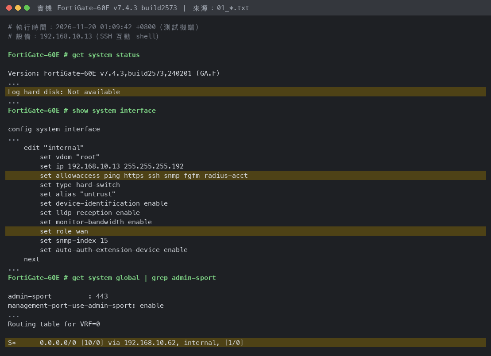

| 欄位 | 實機值 | 說明 |
|---|---|---|
| 版本 | v7.4.3 build2573 | 本文適用版本 |
| WAN 介面 | `internal`，role wan，預設路由在這 | ★ lab 才這樣，現場通常是 wan1 |
| allowaccess | ping https ssh snmp fgfm radius-acct | 有 ssh、沒有 telnet |
| admin-sport | 443 | 跟 SSL VPN 測試埠 10443 不同 |

> ★ **誘餌埠只能用沒被 allowaccess 打開的埠**。這台 ssh 有開，連 22 不會產生 local-in deny；telnet 沒開，所以實測用 23。
>
> ★ `Log hard disk: Not available`：沒有硬碟，log 只在記憶體。這點在 5-4 會咬人。

### 1-2 SSL VPN 設定

**指令**：`show vpn ssl settings`

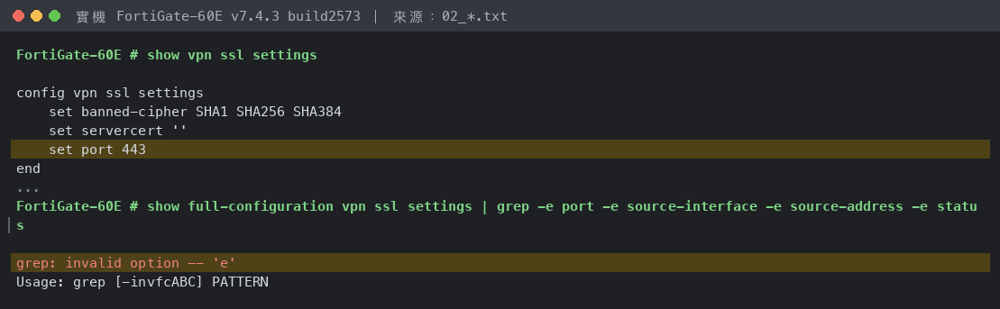

| 欄位 | 實機值 | 說明 |
|---|---|---|
| port | 443 | 動手前原值，沒設 source-interface＝沒在聽 |
| grep -e | 不支援 | FortiOS 的 grep 一次只能一個關鍵字 |

> ★ `show` 不顯示預設值。7.4.3 的 SSL VPN 預設埠是 10443，所以 `show vpn ssl settings` 看不到 `set port` 時就是 10443。要看實際值用 `show full-configuration vpn ssl settings`。

### 1-3 既有 local-in

**指令**：`show firewall local-in-policy`、`diagnose firewall iprope list 100001`

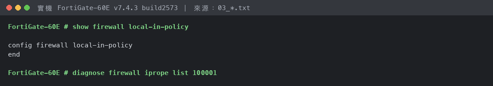

> 空的。`iprope list 100001` 沒有任何輸出就是沒有規則。

### 1-4 IPsec 對端

**指令**：`show vpn ipsec phase1-interface`、`get system settings | grep ike-port`

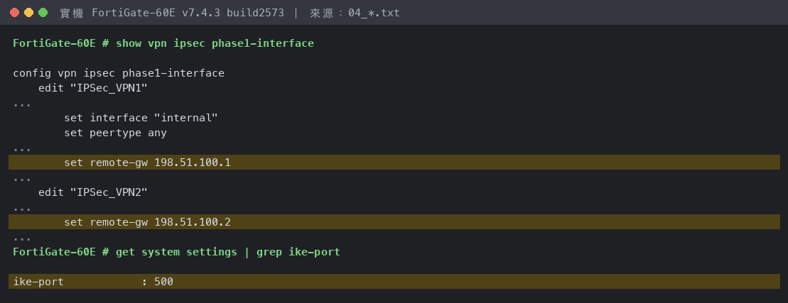

| 欄位 | 實機值 |
|---|---|
| 對端 1 | 198.51.100.1（IPSec_VPN1） |
| 對端 2 | 198.51.100.2（IPSec_VPN2） |
| ike-port | 500 |

> ★ `show` **不顯示 `set type static`**（預設值）。固定 IP 對端只看得到 `set remote-gw`，看到它就抄進 S2S-PEERS。

### 1-5 TCP 4500、detect-unknown-esp、syslogd2、local-in log

**指令**：見圖

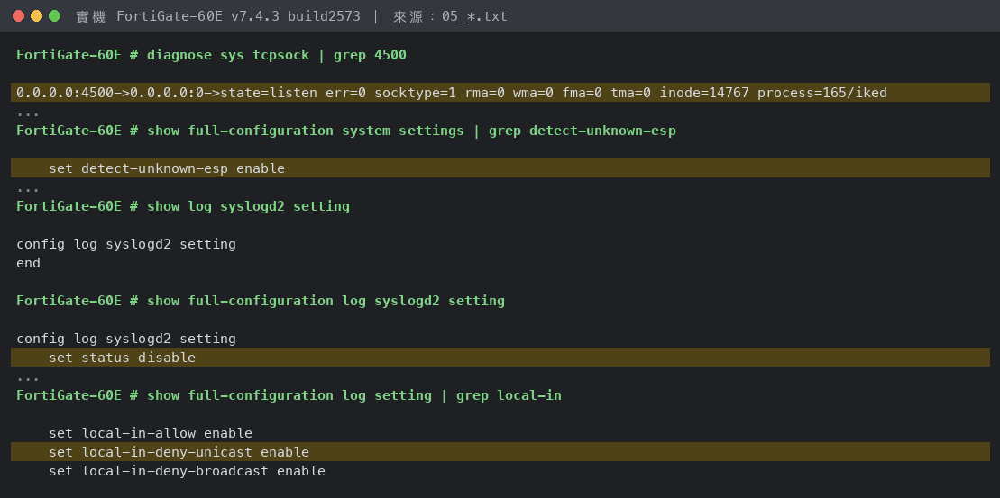

| 欄位 | 實機原值 | 說明 |
|---|---|---|
| TCP 4500 | 有在聽（iked） | 內建 IKE 服務只含 UDP |
| detect-unknown-esp | enable | 只記下，不改 |
| syslogd2 | disable | 沒人在用，可以拿來送收集器 |
| local-in-deny-unicast | **enable** | ★ 退回時要還原成這個值 |

> ★ **`local-in-deny-unicast` 先記原值**。官方預設是 disable，但這台原本就是 enable。退回時一律 disable 會把原本的設定改壞。

### 1-6 ★ lab 專屬：測試端的來源 IP

**指令**：`get system info admin status`、`diagnose sys session list`

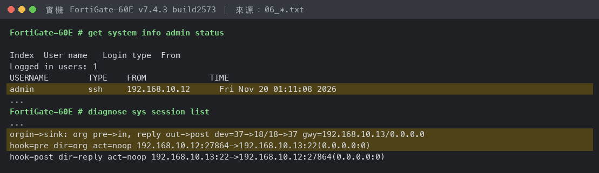

> ★ 測試機經 lab 內一台 VPN 子網路由器（同一台也跑收集器）SNAT 連進來，**FortiGate 看到的來源一律是 192.168.10.12**，入口介面 internal（dev 37）。後面所有「被擋的 IP」都是它。

---

## 二、建物件

### 2-1 地區物件 GEO-TW

**CLI**：`config firewall address` → `edit "GEO-TW"`

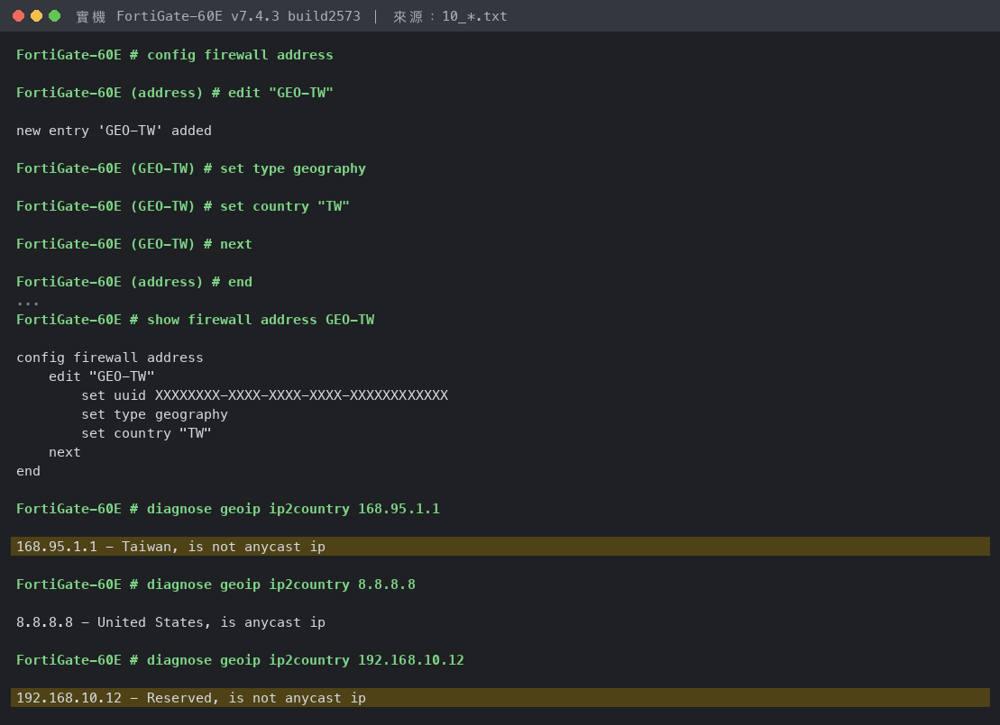

| 查詢 | 實機結果 |
|---|---|
| 168.95.1.1 | Taiwan |
| 8.8.8.8 | United States |
| 192.168.10.12 | Reserved |

> ★ 沒有 FortiGuard 授權，`diagnose geoip ip2country` 照樣查得到。
>
> ★ 私有位址查出來是 **Reserved**，不屬於任何國家。所以 lab 測不到「只放台灣」那條規則。

### 2-2 外部惡意 IP 清單 ATTACKER-FEED

**CLI**：`config system external-resource` → `edit "ATTACKER-FEED"`

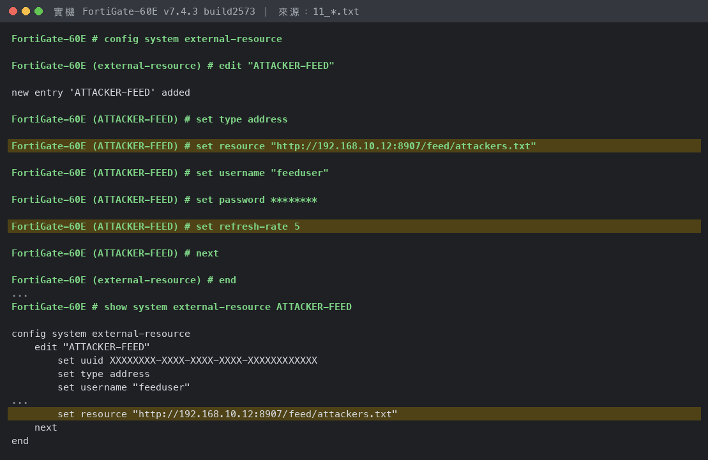

| 欄位 | 實機值 |
|---|---|
| type | address |
| resource | `http://192.168.10.12:8907/feed/attackers.txt` |
| username | feeduser（範例帳號；密碼已遮蔽） |
| refresh-rate | 5（預設值，`show` 不顯示） |

> ★ 打了 `set refresh-rate 5` 但 `show` 看不到，因為 5 是預設值。

### 2-3 site-to-site 對端群組 S2S-PEERS

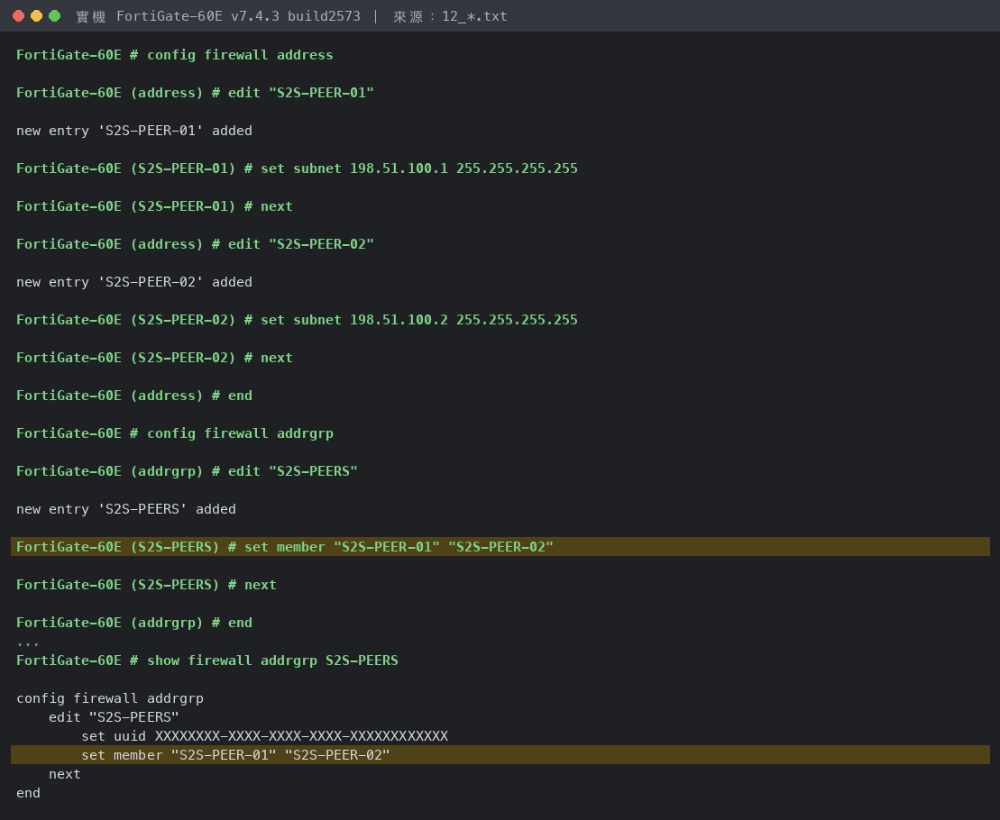

> 1-4 抄到的兩個對端各建一個 /32，再收成群組。

### 2-4 服務物件 SSLVPN-10443（順便確認內建 IKE）

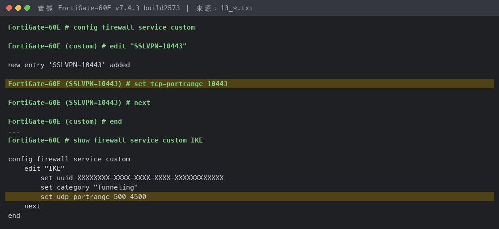

> ★ 內建 `IKE` 實機確認是 **UDP 500、4500**，不含 TCP 4500。

### 2-5 驗證清單有沒有建起來

**指令**：`diagnose sys external-address-resource list`

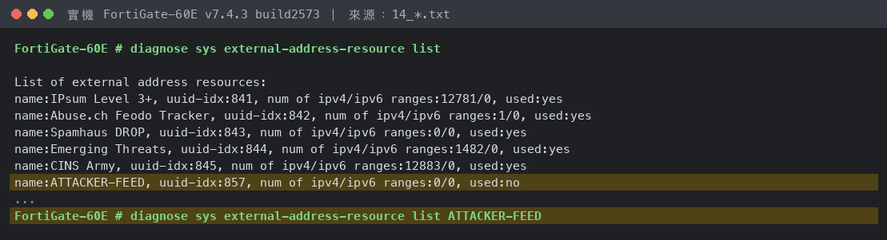

| 指令 | 7.4.3 實機結果 |
|---|---|
| `list`（不帶名稱） | 有輸出，看 ATTACKER-FEED 那一行 |
| `list ATTACKER-FEED`（帶名稱） | **沒有任何輸出** |

> ★ 看 `num of ipv4/ipv6 ranges:0/0` 判斷筆數。observe 時 0 筆是正常的。
>
> ★ `used:no` 是因為還沒有規則引用它；建完 local-in 後會變 `used:yes`（見 3-2）。
>
> ★ `execute update-external-resource ATTACKER-FEED` 可以叫 FortiGate 馬上拉一次，不用等 5 分鐘。

### 2-6 ★ lab 專屬：讓 SSL VPN 聽 10443

這台原本 SSL VPN 沒在用，要先讓它聽 10443 才測得到。現場正在用 SSL VPN 的可以跳過。

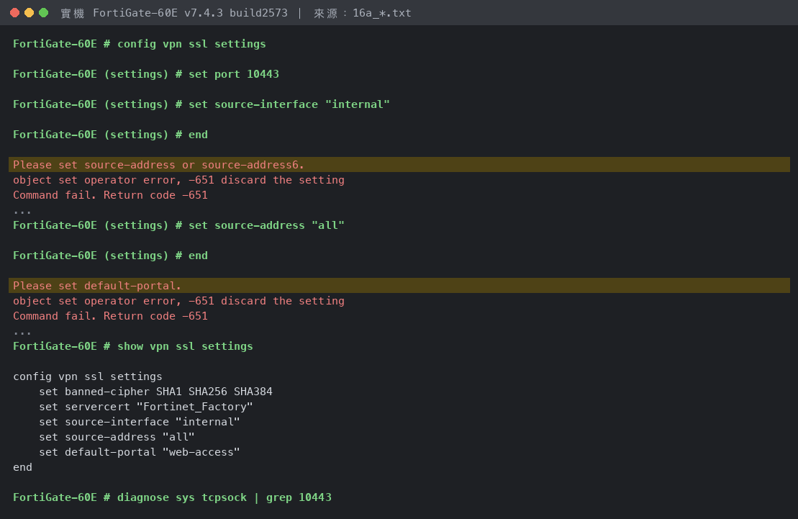

> ★ 只設 port＋source-interface 會被拒（`-651`，整段丟棄）。要再補 `source-address`，接著還要 `default-portal`，才存得進去。

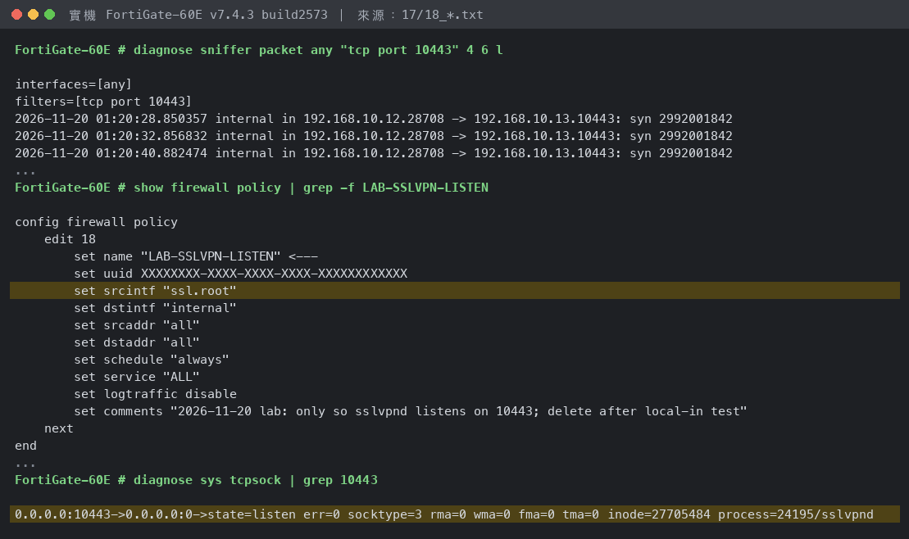

> ★★ **設定存進去了，10443 還是沒在聽**（sniffer 只看到 SYN，沒有回應）。要有一條 `srcintf ssl.root` 的防火牆政策，sslvpnd 才會聽。lab 建了一條 deny 政策 18，測完已刪（見 6-4）。

---

## 三、local-in 規則

### 3-1 建規則 5／10／20／90

**CLI**：`config firewall local-in-policy`（7.4.3 只能用 CLI 建）

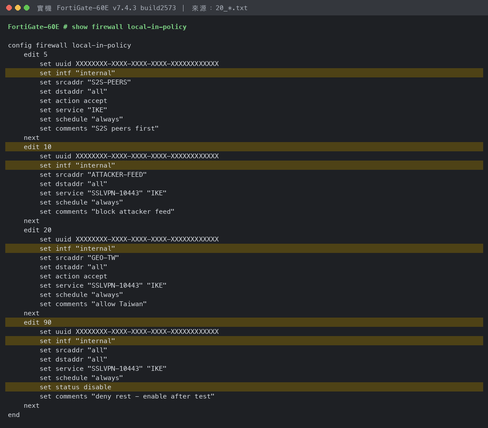

| 規則 | 來源 | 服務 | 動作 |
|---|---|---|---|
| 5 | S2S-PEERS | IKE | accept |
| 10 | ATTACKER-FEED | SSLVPN-10443、IKE | deny |
| 20 | GEO-TW | SSLVPN-10443、IKE | accept |
| 90 | all | SSLVPN-10443、IKE | deny（先停用） |

> ★ 規則 10、90 打了 `set action deny`，`show` 卻看不到——因為 deny 是預設值。**反過來說，規則 20 一定要寫 `set action accept`**，漏寫就變成擋台灣。
>
> ★ `set intf "internal"` 是 lab 值，現場換成你的 WAN。

### 3-2 確認規則載入核心

**指令**：`diagnose firewall iprope list 100001`

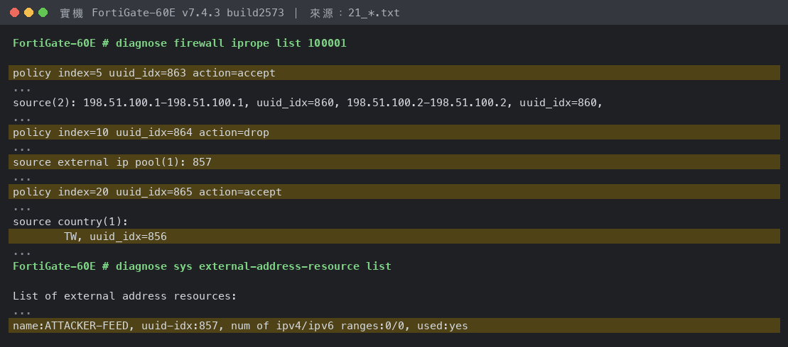

> ★ 只看得到 5、10、20。**停用的規則 90 不會出現在 iprope list**，這是正常的。
>
> ★ 規則 10 的來源顯示成 `source external ip pool(1): 857`（857 是 ATTACKER-FEED 的 uuid-idx），規則 20 顯示 `source country(1): TW`。清單這時變成 `used:yes`。

---

## 四、log 與收集器

### 4-1 syslogd2 送收集器（★ 會跳 y/n）

**CLI**：`config log syslogd2 setting`

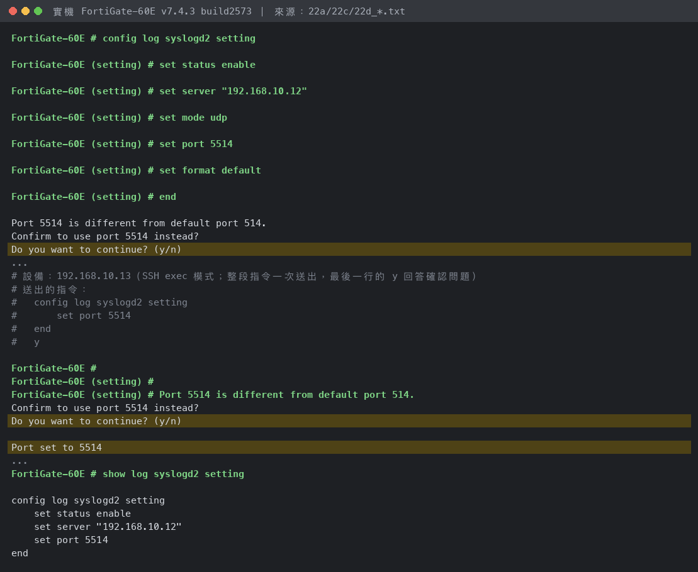

| 欄位 | 實機值 |
|---|---|
| server | 192.168.10.12 |
| port | 5514 |
| mode／format | udp／default（預設值） |

> ★★ **非預設埠在 `end` 時會跳 `Do you want to continue? (y/n)`，要回答 `y`**。
>
> ★ 沒回答時，status 和 server 其實已經生效，只有 port 沒改（還是 514）。所以收集器會以為 FortiGate 沒送 log。lab 後來改成整段一次送出、最後一行補 `y`，只改 port 才成功（圖中段）。

### 4-2 local-in deny 的 log 開關

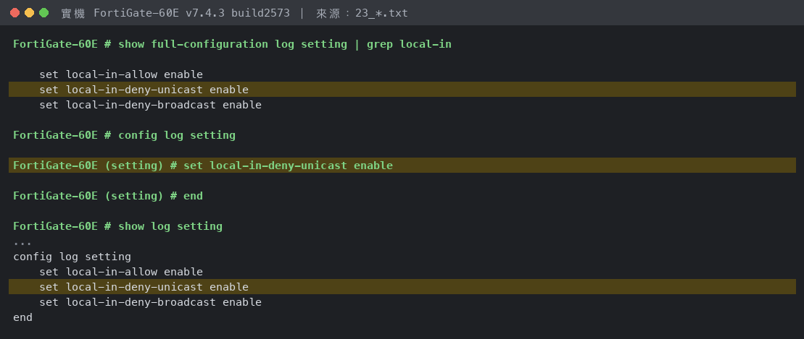

> ★ 這台原本就是 enable，這步是空操作。重點是 1-5 先把原值記下來。

### 4-3 收集器 observe：收到帶序號的 log

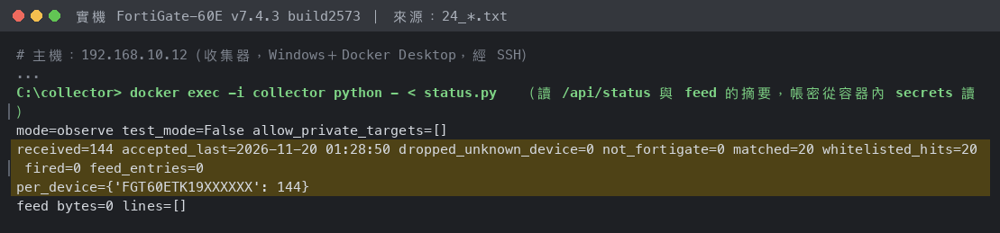

| 欄位 | 實機值 | 說明 |
|---|---|---|
| received | 144 | 收到 144 筆 |
| dropped_unknown_device | 0 | 全部依序號比對成功 |
| feed bytes | 0 | observe 不產清單 |

> 真機 syslog 帶 devid（序號）與 devname，收集器可以靠序號認設備。

### 4-4 ★ SSL VPN 登入失敗：這台產生不出 39426

測試端用假帳密打 5 次 `/remote/logincheck`，5 次都是 Empty reply。FortiGate 端只看到這些：

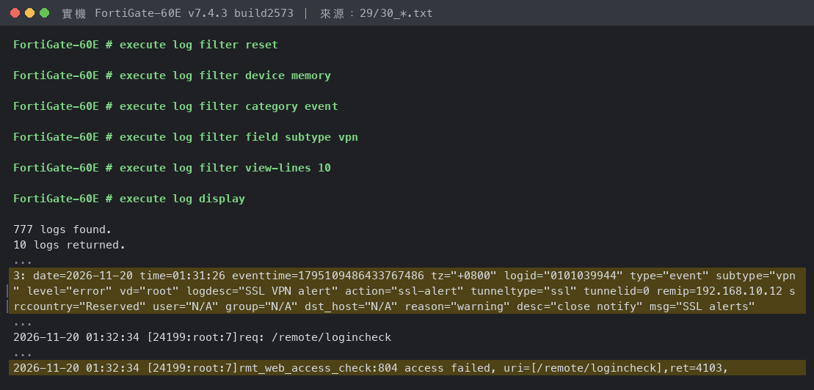

> ★★ 記憶體 log 只有 39944「SSL VPN alert / close notify」，**沒有登入失敗的 39426**。debug 顯示 sslvpnd 在驗帳密之前就拒絕了（`ret=4103`）。
>
> 原因：lab 只有一條 deny 的 ssl.root 政策。要測這條，要有放行的 ssl.root 政策加使用者群組，這次沒做。**所以「登入失敗觸發封鎖」仍未實測**，下面改用誘餌埠 23 觸發同一條鏈。

---

## 五、實測：誘餌觸發 → 清單 → 擋住

（收集器這時已切 enforce，並暫時允許封私有位址 192.168.10.12/32，狀態頁會顯示「測試模式」警告。測完已清掉。）

### 5-1 碰誘餌埠 23，收集器判定封鎖

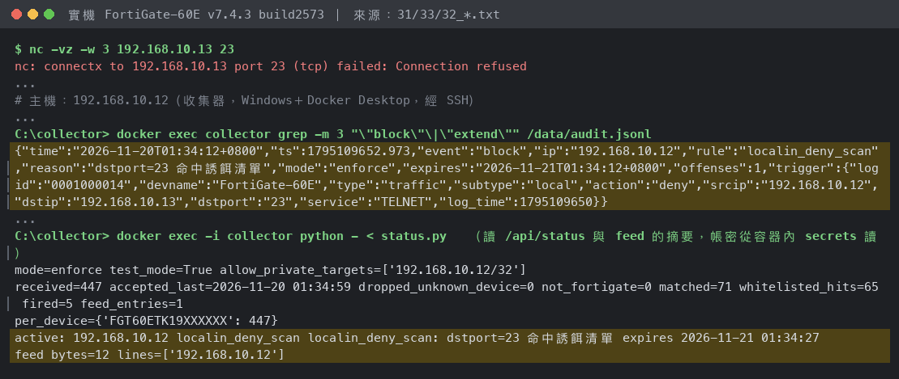

| 欄位 | 實機值 |
|---|---|
| 觸發 log | logid 0001000014，dstport 23，service TELNET |
| 判定規則 | localin_deny_scan（命中誘餌清單） |
| 封鎖期限 | 24 小時 |
| feed 內容 | `192.168.10.12` |

> ★ 測試端顯示 Connection refused，但**那個 RST 不是 FortiGate 送的**，是中間的 VPN 子網路由器回的（見 5-5）。
>
> ★ 一次連線記了 5 筆 deny（SYN 重送 5 次），offenses 一次就到 5。
>
> 註：公開版的 IP 都換成了假位址，圖 20、21 裡 `feed bytes` 的數字是原始環境的值，所以跟畫面上的 IP 長度對不上，屬正常。

### 5-2 FortiGate 拉回清單

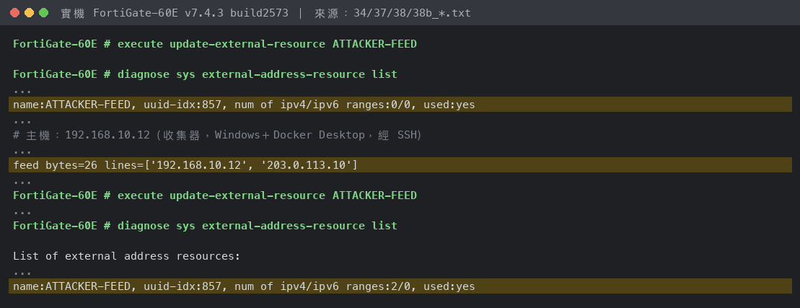

> ★ 第一次 update 後還是 0 筆（原因不明，只遇到一次）。收集器加了一個公網測試 IP 後再 update 一次，變成 2 筆。**這也證明 FortiGate 不會把私有 IP 從清單濾掉。**
>
> 實務做法：update 完一定再看一次筆數，沒上來就再 update 一次。

### 5-3 規則 10 擋住 10443，管理照常

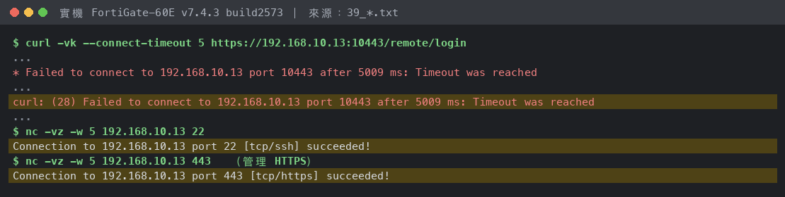

| 連線 | 結果 |
|---|---|
| 10443（SSL VPN） | curl 逾時 |
| 22（SSH 管理） | 成功 |
| 443（HTTPS 管理） | 成功 |

### 5-4 規則命中數

**指令**：`diagnose firewall iprope show 100001 10`

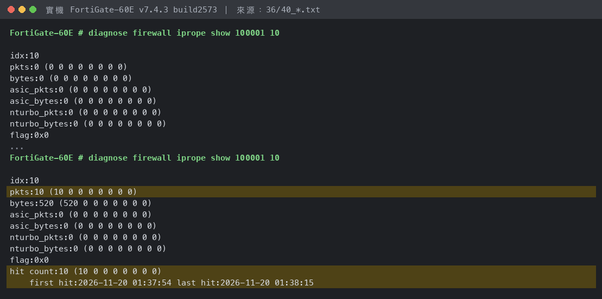

> ★ 上半是清單 0 筆時（命中 0），下半是擋住之後（命中 10）。
>
> ★ **`hit count` 和 `first hit／last hit` 只有命中過才會出現**，沒命中的規則只有 pkts／bytes。

### 5-5 ★ 被擋時 FortiGate 不回 RST

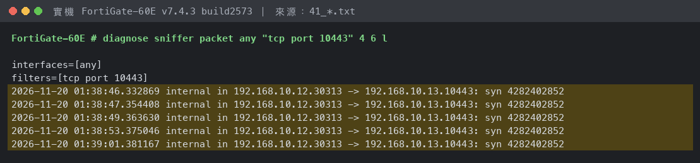

> ★ 同一個 SYN 重送 5 次，FortiGate 一個都沒回（只有 in，沒有 out）。local-in deny 是**靜默丟棄**。測試端若看到 refused，是中間設備回的。

### 5-6 ★ 記憶體 log 看不到 local-in deny

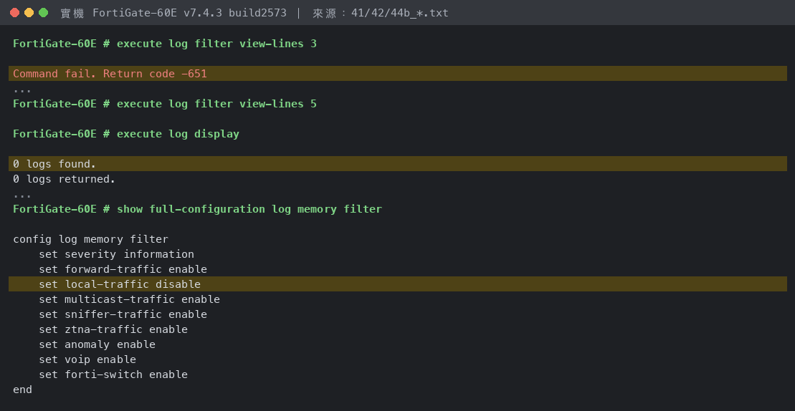

> ★ `execute log filter view-lines` **小於 5 會報錯**（-651）。
>
> ★★ 這台 `log memory filter` 的 **`local-traffic` 是 disable**，所以 local-in deny 根本不進記憶體 log，只送到 syslog。沒硬碟的小機型要查 local-in log，就看收集器或 syslog 伺服器。

### 5-7 啟用規則 90，用 debug flow 看它丟棄

先啟用並把計數歸零：

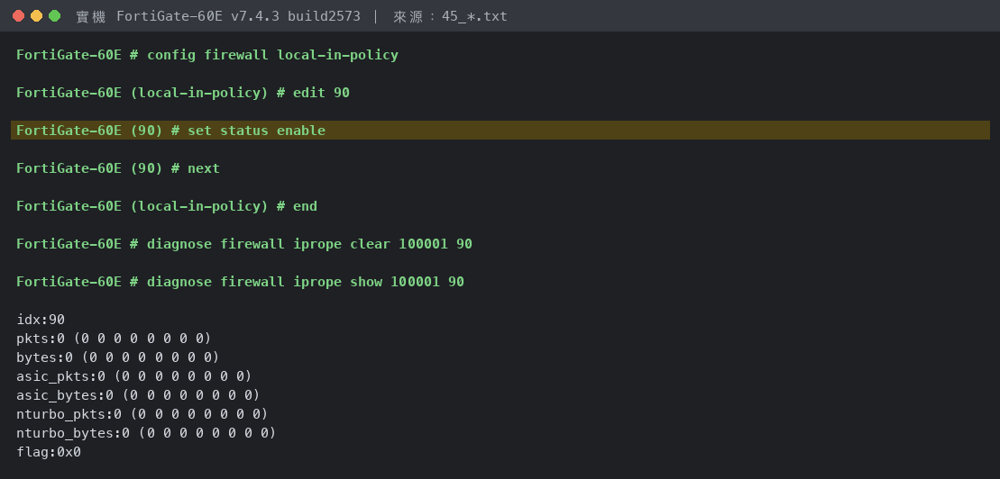

再用 debug flow 看判斷過程：

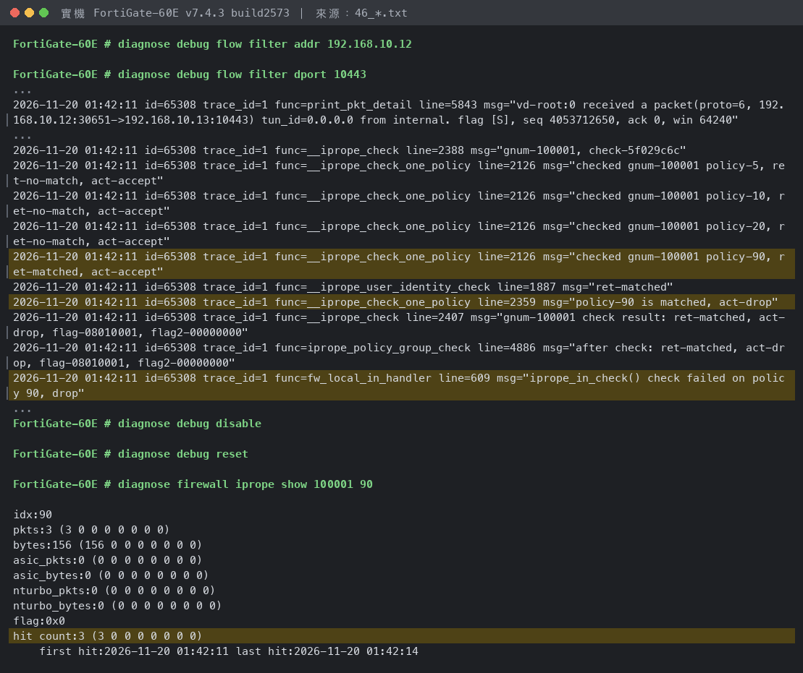

| 要看的行 | 意思 |
|---|---|
| `policy-90, ret-matched, act-accept` | ★ 只是「比對吻合」，**不是放行** |
| `policy-90 is matched, act-drop` | 真正的動作：丟棄 |
| `check failed on policy 90, drop` | 最終結果 |

> ★ 跟官方 KB 預期的訊息一字不差。命中後 `hit count:3`，有 first hit／last hit。
>
> ★ 測完一定要 `diagnose debug disable` 和 `diagnose debug reset`（圖下段）。

---

## 六、退回

### 6-1 最快止血：停用規則 90

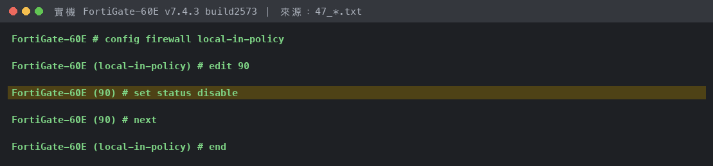

> 停用指令執行成功。停用後的重連測試沒有留下紀錄，視為**未實測**。

### 6-2 完整拿掉

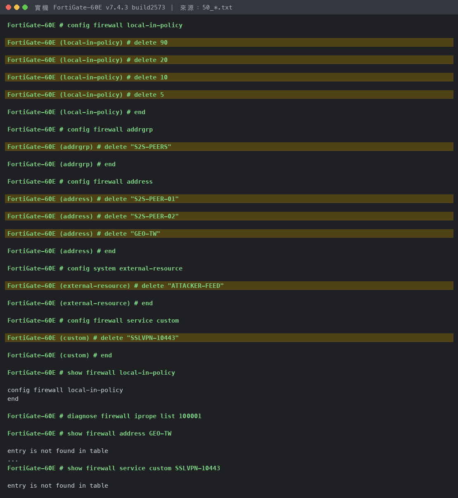

> 照「規則 → 群組 → 位址 → 清單 → 服務」的順序刪，一次成功。最後 5 個查詢都是空的或 `entry is not found`。

### 6-3 ★ syslogd2 退回（照原教學會卡住）

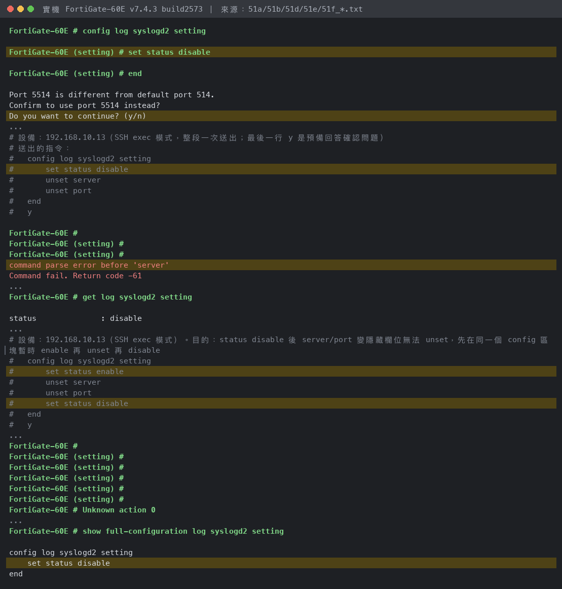

| 寫法 | 實機結果 |
|---|---|
| 只下 `set status disable` | ★ 又跳 y/n（port 還是 5514） |
| 先 disable 再 unset server／port | ★ unset 報 parse error（-61） |
| 先 enable → unset → 再 disable（同一區塊） | 成功，沒有錯誤也沒有 y/n |

> ★★ disable 之後 server／port 變成隱藏欄位，`show` 和 `get` 都看不到，也 unset 不掉。正確寫法：
>
> ```
> config log syslogd2 setting
>     set status enable
>     unset server
>     unset port
>     set status disable
> end
> ```
>
> 圖中的 `Unknown action 0` 是預備用來回答 y/n 的那行 `y`，這次沒跳提示，就被當成指令，無害。

`local-in-deny-unicast` 這台原本就是 enable，所以**不動**。

### 6-4 還原後跟動手前比對

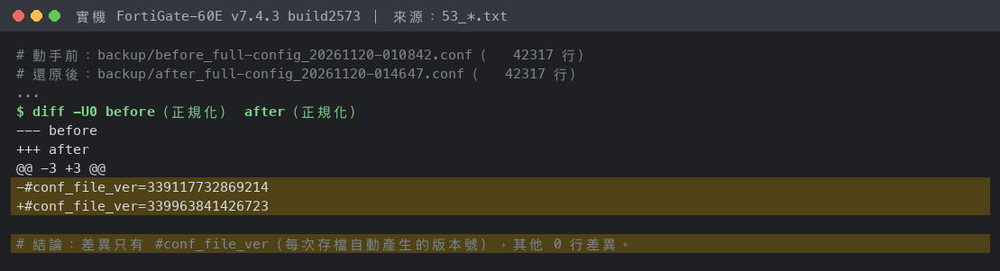

> 兩份完整組態比對，只差 `#conf_file_ver`（每次存檔自動產生的版本號）。lab 另外刪了政策 18、SSL VPN 設回 443。

---

## 七、尚未實機驗證

- 「放行台灣」規則 20：lab 來源是私有位址（Reserved），測不到。要用台灣公網 IP 實測。
- 從國外 IP 打 10443／UDP 500 被規則 90 擋：只用私有來源測過規則 90 的丟棄行為。
- SSL VPN 登入失敗（39426）觸發封鎖：見 4-4。
- `detect-unknown-esp` 對 IKE 的影響：沒測。

## 相關文件

- [純文字版](FortiGate-LocalIn設定教學_7.4.3_20261120.md) — 部署照做，含 12 條實測更正
