# FortiGate Captive Portal + Entra ID SAML — 圖文設定說明

> [!NOTE]
> **測試環境**：FortiGate-60E，FortiOS **v7.4.12 build2902**（繁體中文介面）；FortiAP 231F（bridge mode）；Microsoft Entra ID 免費版。
> 「二之三、多 VLAN」一節的截圖來自另一台 **FortiOS 7.2.0** 驗證環境（VM）。
>
> **截圖已去識別化**：租戶 ID、應用程式 ID、物件 ID、群組 ID、憑證指紋、簽署憑證與應用程式的日期、帳號、MAC、內網 IP 都已用實心色塊蓋掉，並寫上示範值（例如 `<TENANT-ID>`、`<到期日>`、`192.168.20.1`、`contoso`）。畫面上的示範值與本文一致。

> [!WARNING]
> 本文是個人實測紀錄，**僅供參考，使用風險自負**。不同 FortiOS 版本的介面與預設值可能不同，正式環境請先在測試機驗證。

本文是 [純文字版](captive-portal-entra-saml-guide.md) 的**圖文對照版**。

兩份文件的關係：
- 純文字版 = CLI 指令與踩坑總表，**部署時照著推**
- 本圖文版 = GUI 對照，**教學、交接**用

---

## 〇、先看懂這張架構

```
① 使用者連上 SSID「SAML-Test」（bridge mode，打 VLAN 100 tag）
        ↓
② 流量經交換器 trunk 進 FortiGate 的 vlan-saml 介面
        ↓
③ vlan-saml 發 DHCP，使用者拿到 192.168.20.x
        ↓
④ 介面上的 Captive Portal 攔下未認證流量
        ↓
⑤ 導向 Entra ID → 使用者登入（含 MFA）
        ↓
⑥ Entra 回傳 Assertion（username = UPN、group = 群組 GUID）
        ↓
⑦ FortiGate 用 REMOTE_Cert_Entra 驗簽 → 比對群組 GUID → 放行
```

三個貫穿全文的重點：

1. **SP 與 IdP 之間全程沒有直接連線**，所有交握都經使用者瀏覽器轉送。沒有瀏覽器就跑不了 SAML。
2. **信任根是一張憑證**（`REMOTE_Cert_Entra`）。憑證換掉或過期，整套失效。
3. **exempt 政策必須排在認證政策前面**。使用者去 IdP 登入的當下他還沒通過認證，沒有放行規則連登入頁都打不開。

---

## 一、Part A — Entra ID 側設定

測試租戶：`contoso.onmicrosoft.com`（**Microsoft Entra ID 免費版**）
租戶識別碼：`<TENANT-ID>`

### A-1 建立 Enterprise Application

**入口**：<https://entra.microsoft.com> → Entra ID → 企業應用程式

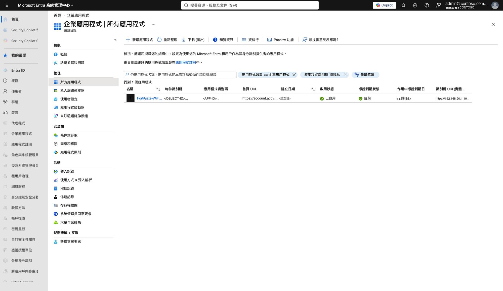

| 欄位 | 測試值 |
|---|---|
| 名稱 | `FortiGate-WiFi-Portal` |
| 物件識別碼 | `<OBJECT-ID>` |
| 應用程式識別碼 | `<APP-ID>` |
| 建立日期 | `<建立日>` |
| 作用中憑證到期日 | `<憑證到期日>` |

建立方式：**新增應用程式 → 建立您自己的應用程式 → 選「非資源庫應用程式」**。
不要去資源庫找 Fortinet 的範本，captive portal 這個用法沒有現成範本。

> ★ WiFi 與 VPN 要**各建一個** Enterprise Application。
> 兩者的 entity-id 與路徑不同（`/saml/metadata/` vs `/remote/saml/metadata/`、port 1003 vs 10428），不能共用。

### A-2 基本 SAML 設定

**路徑**：應用程式 → 單一登入 → SAML → 區塊 ①「基本 SAML 設定」→ 編輯

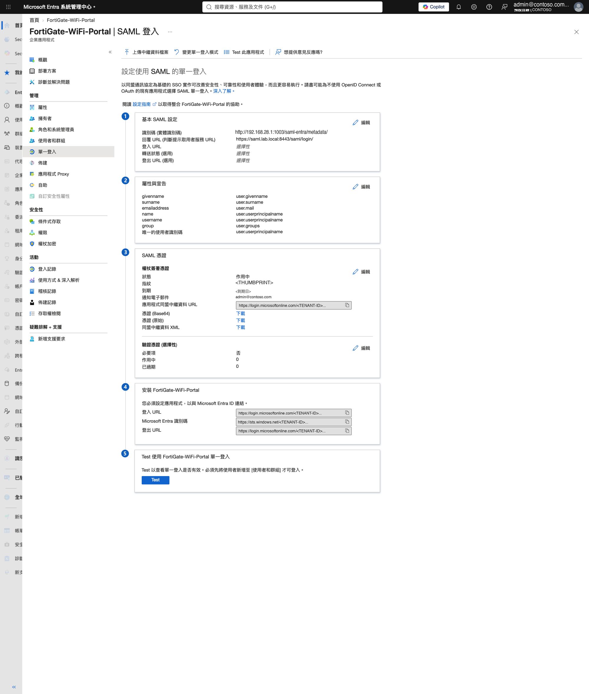

上面這張是 SAML 設定總覽，**Part A 的五個步驟全在這一頁**（①基本設定 ②屬性與宣告 ③憑證 ④要填回 FortiGate 的值 ⑤測試）。

點區塊 ① 的「編輯」展開後才看得到完整清單：

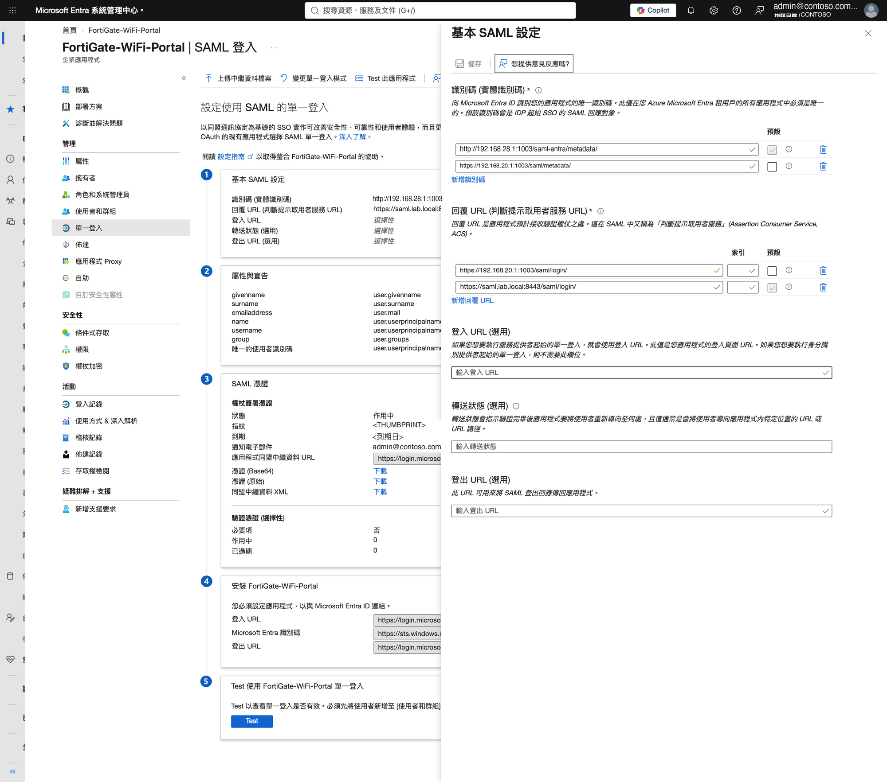

這一組要填的值：

| 項目 | 值 |
|---|---|
| 識別碼（實體識別碼） | `https://192.168.20.1:1003/saml/metadata/` |
| 回覆 URL（ACS） | `https://192.168.20.1:1003/saml/login/` |

> ★★ **識別碼與回覆 URL 都可以有多筆。** 截圖裡看到兩組，是因為這個應用程式同時服務兩個驗證環境。
> 這個特性正是**多 VLAN 佈署的關鍵**——每多一個要做 SAML 的 VLAN，就在**同一個應用程式**裡
> 增列一組識別碼與回覆 URL，不必另建應用程式。詳見「二之三」。
>
> ★ **識別碼與回覆 URL 必須與 FortiGate 的 `entity-id`／`single-sign-on-url` 逐字元一致**，含結尾斜線。
> 對不上時 Entra 會回 `Invalid requester`。
>
> ★ **回覆 URL 一定要 `https://`**，填 `http://` 會被擋（錯誤訊息：請輸入以「https://」開頭的有效 URL）。
> 所以 FortiGate 端的 `auth-secure-http` 必須開（見 B-6）。
>
> ★ **已驗證：Entra 接受私有 IP 與內部網域**。因為 SAML 是 front-channel 協定，
> IdP 從不主動連線 SP，Entra 對回覆 URL 只做**格式驗證**、不做可達性檢查。

### A-3 屬性與宣告（★ 最容易錯的一段）

**路徑**：單一登入 → 區塊 ②「屬性與宣告」→ 編輯

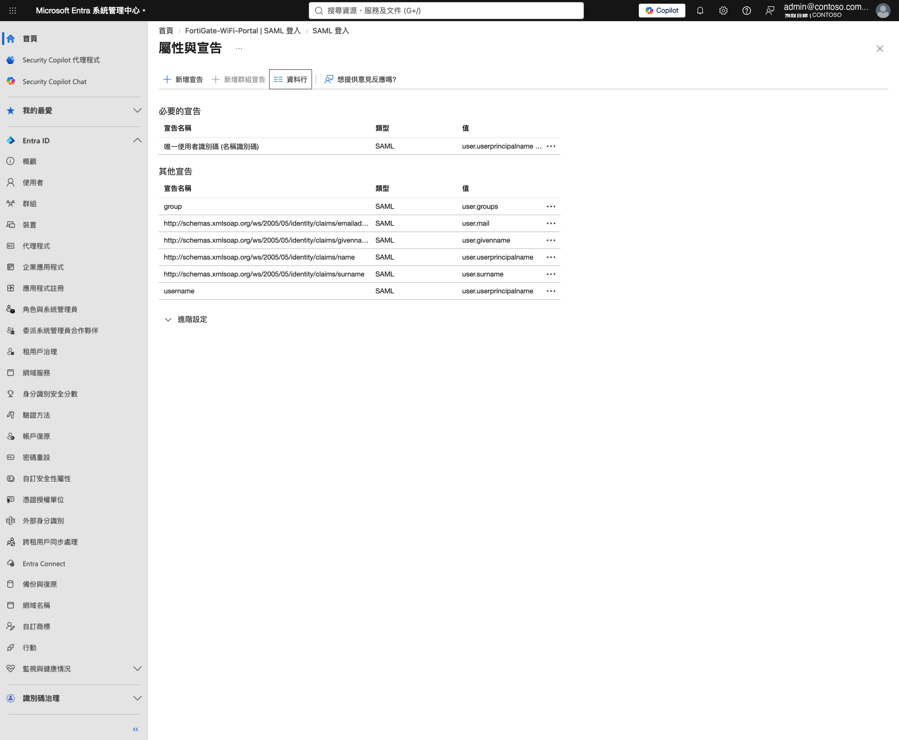

這張圖的重點在**宣告名稱的長短對比**：

| 宣告名稱 | 值 | 說明 |
|---|---|---|
| `username` | `user.userprincipalname` | ★ 短名稱，FortiGate 的 `set user-name "username"` 對應這個 |
| `group` | `user.groups` | ★ 短名稱，FortiGate 的 `set group-name "group"` 對應這個 |
| `http://schemas.xmlsoap.org/.../emailaddress` | user.mail | 預設宣告，帶長 URI |
| `http://schemas.xmlsoap.org/.../givenname` | user.givenname | 預設宣告 |
| `http://schemas.xmlsoap.org/.../name` | user.userprincipalname | 預設宣告 |
| `http://schemas.xmlsoap.org/.../surname` | user.surname | 預設宣告 |

> ★★ **FortiGate 只認短名稱。**
> 新增宣告時如果「命名空間」欄位填了東西，名稱就會變成上表下半那種
> `http://schemas.xmlsoap.org/...` 長 URI，FortiGate 抓不到，症狀是登入成功但沒帶到帳號或群組。
> **命名空間必須留空。**

#### 群組宣告的細部設定

點宣告清單裡的 `group` 那一列展開：

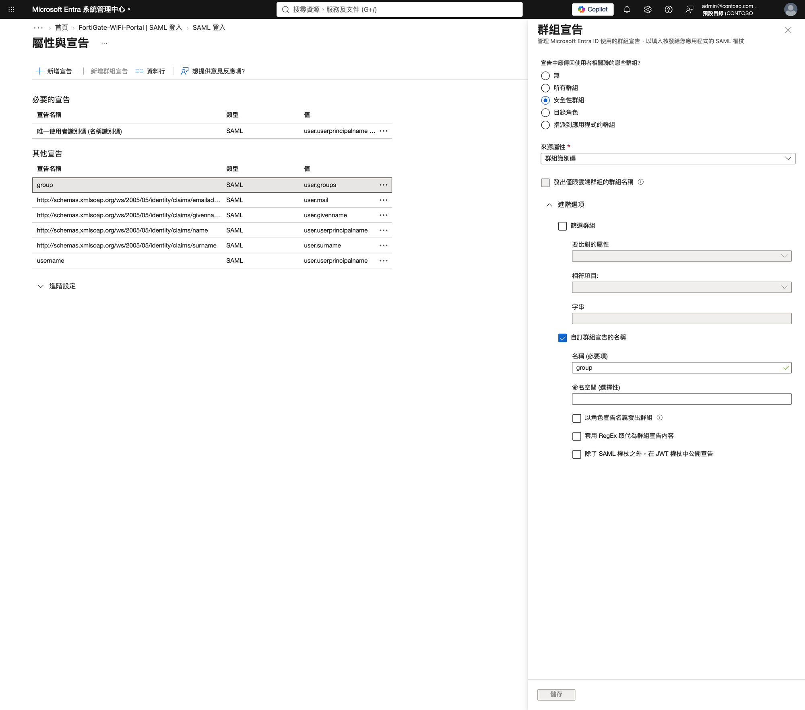

| 欄位 | 測試值 | 說明 |
|---|---|---|
| 宣告中應傳回哪些群組 | **安全性群組** | |
| 來源屬性 | **群組識別碼** | ★ 這決定了送出來的是 **GUID** 而不是群組名稱 |
| 自訂群組宣告的名稱 | ☑ 勾選 | |
| 名稱（必要項） | `group` | 對應 FortiGate 的 `set group-name "group"` |
| **命名空間（選擇性）** | **空白** | ★★ 填了就變長 URI，FortiGate 認不得 |

### A-4 簽章憑證

在同一頁的區塊 ③「SAML 憑證」（見 A-2 的總覽圖）：

| 欄位 | 測試值 |
|---|---|
| 狀態 | 作用中 |
| 指紋 | `<THUMBPRINT>` |
| 到期 | **`<憑證到期日>`**（日期＋時間） |
| 通知電子郵件 | `admin@contoso.com` |

下載「**憑證 (Base64)**」→ 這個檔案就是 B-0 要匯入 FortiGate 的 PEM。

> ★ 到期日要與 FortiGate 上 `REMOTE_Cert_Entra` 的到期日對得起來（實測兩邊是同一天，見 B-0）。
> 憑證輪替時**兩邊都要換**，只換一邊整套 SAML 立刻停擺。

### A-5 指派使用者與群組

**路徑**：應用程式 → 使用者和群組

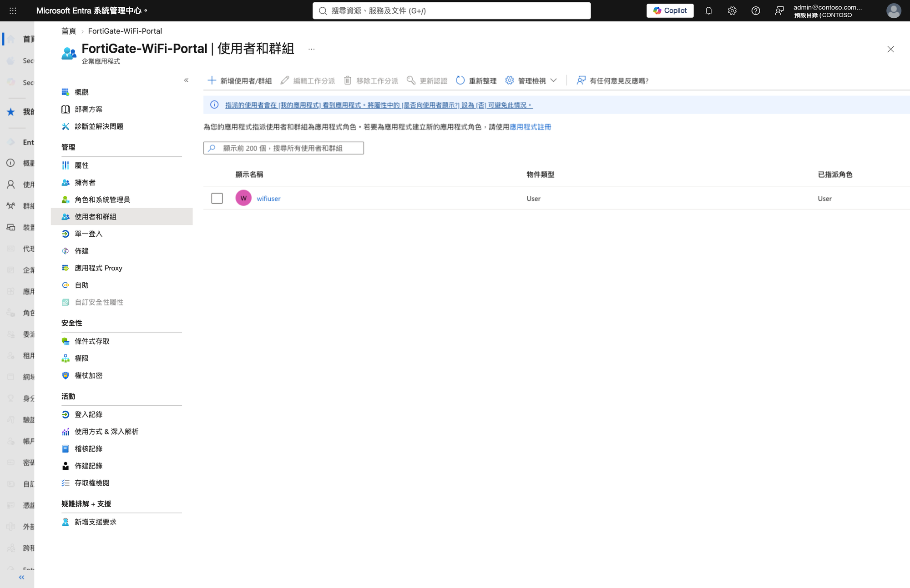

測試租戶只指派了一個使用者 `wifiuser`（物件類型 User、已指派角色 User），**沒有指派群組**。

> ★★ **免費版不能把「群組」指派給企業應用程式**（那是 P1/P2 功能），只能一個一個指派使用者。
> 但**這不影響授權**——群組**宣告**照樣會把使用者所屬的安全性群組 GUID 送出來，
> FortiGate 的群組比對仍然成立。如果只是要 SSO + 群組分權，**免費版就夠**；
> 要「用群組管理誰能用這個應用程式」或條件式存取，才需要 P1。

#### 群組的 Object ID（★ 要填進 FortiGate 的就是這串）

**路徑**：Entra ID → 群組 → 所有群組

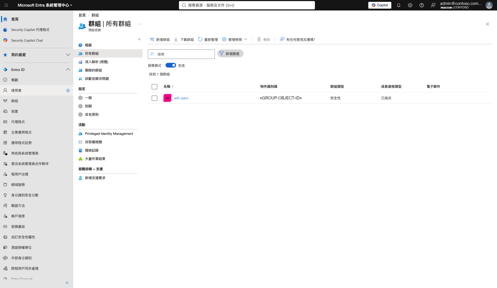

| 群組名稱 | 物件識別碼 | 群組類型 |
|---|---|---|
| `wifi-users` | **`<GROUP-OBJECT-ID>`** | 安全性 |

把這串 GUID 原封不動填進 FortiGate 用戶群組的「群組名稱」（見 B-5）。**兩邊必須一模一樣。**

### A-6 Entra 端要抄回 FortiGate 的三個值

單一登入頁面的區塊 ④「安裝 FortiGate-WiFi-Portal」，完整值（`<TENANT-ID>` = 你的租戶識別碼）：

| Entra 欄位 | 值 | 對應 FortiGate 參數 |
|---|---|---|
| 登入 URL | `https://login.microsoftonline.com/<TENANT-ID>/saml2` | `set idp-single-sign-on-url` |
| Microsoft Entra 識別碼 | `https://sts.windows.net/<TENANT-ID>/` | `set idp-entity-id` |
| 登出 URL | `https://login.microsoftonline.com/<TENANT-ID>/saml2` | `set idp-single-logout-url` |

> ★ `idp-entity-id` 是 `sts.windows.net` 開頭、**結尾有斜線**；
> 登入／登出 URL 是 `login.microsoftonline.com` 開頭、**結尾沒有斜線**。兩者容易抄混。

---

## 一之二、Entra ↔ FortiGate 對照總表

整套設定真正的難點是「哪個值要填到哪裡」。這張表把兩邊接起來：

| # | Entra ID 這樣設 | 值 | FortiGate 這樣接 |
|---|---|---|---|
| 1 | 基本 SAML → 識別碼 | `https://192.168.20.1:1003/saml/metadata/` | `config user saml` → `set entity-id` |
| 2 | 基本 SAML → 回覆 URL | `https://192.168.20.1:1003/saml/login/` | `set single-sign-on-url` |
| 3 | 安裝區塊 → 登入 URL | `https://login.microsoftonline.com/<TENANT-ID>/saml2` | `set idp-single-sign-on-url` |
| 4 | 安裝區塊 → Entra 識別碼 | `https://sts.windows.net/<TENANT-ID>/` | `set idp-entity-id` |
| 5 | 憑證 → 下載 Base64 | — | 匯入為 `REMOTE_Cert_Entra` → `set idp-cert` |
| 6 | 宣告 → `username` | user.userprincipalname | `set user-name "username"` |
| 7 | 宣告 → `group`（命名空間空白） | user.groups → 送 GUID | `set group-name "group"` |
| 8 | 群組 `wifi-users` 的物件識別碼 | `<GROUP-OBJECT-ID>` | `config user group` → `config match` → `set group-name <GUID>` |
| 9 | （Entra 用 SHA-256 簽章） | — | `set digest-method sha256`（**預設 sha1，一定要改**） |

---

## 二、Part B — FortiGate 側設定

> **推送順序有意義**：憑證 → 介面/DHCP → SSID → SAML server → 用戶群組 → 防火牆政策 → **最後才掛 portal**。
> 順序顛倒會出現 `entry not found in datasource`，或產生「使用者已被攔住、但 exempt 政策還不存在」的空窗期。

### B-0 匯入 IdP 憑證（第一步，後面所有設定都引用它）

**GUI 路徑**：系統管理 → 憑證

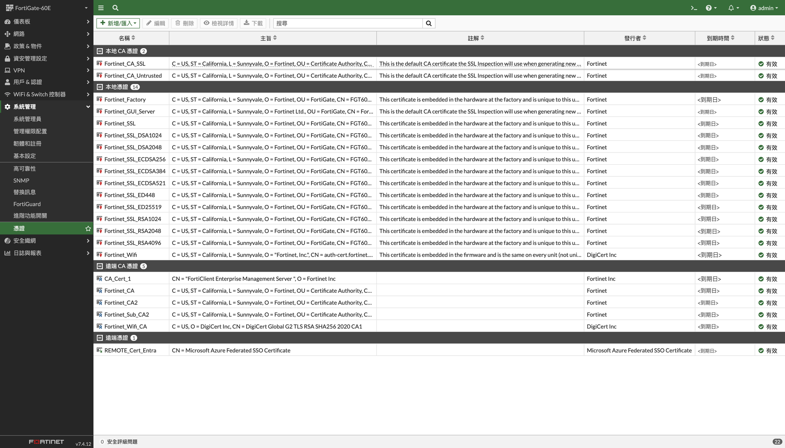

看這張圖要抓三件事：

| 欄位 | 測試值 | 說明 |
|---|---|---|
| 名稱 | `REMOTE_Cert_Entra` | 分類在最下面的「**遠端憑證**」區塊，不是本地憑證 |
| 主旨 / 發行者 | `CN = Microsoft Azure Federated SSO Certificate` | 從 Entra 下載的 Base64 憑證轉 PEM 後匯入 |
| 到期時間 | `<憑證到期日>` | ★ **這個日期要記進維護行事曆**，過期整套 SAML 停擺 |
| 來源 | 用戶 | 代表是手動匯入的，不是出廠內建 |
| 參照 | 1 | 被 `user saml` 物件引用中 |

> ⚠️ **不要走 REST API 匯入**。實測 `cmdb/vpn.certificate/remote` 會**回 success 但憑證是空的**（靜默失敗）。
> GUI 匯入或 CLI 都可以，REST 不行。
>
> ⚠️ 匯入後**無法直接驗證內容**——`remote` 欄位是 write-only，讀回來永遠是空字串。
> 只能靠實測：登入後若 log 出現 `ret=101 (Signature element not found.)`，就是憑證有問題。

### B-1 / B-2 / B-8 VLAN 介面、DHCP、Captive Portal（同一頁）

**GUI 路徑**：網路 → 介面 → 編輯 `vlan-saml`

這一頁把三個步驟都涵蓋了，所以放在一起看。實際部署時仍要照順序推——**captive portal 是最後才掛上去的**。

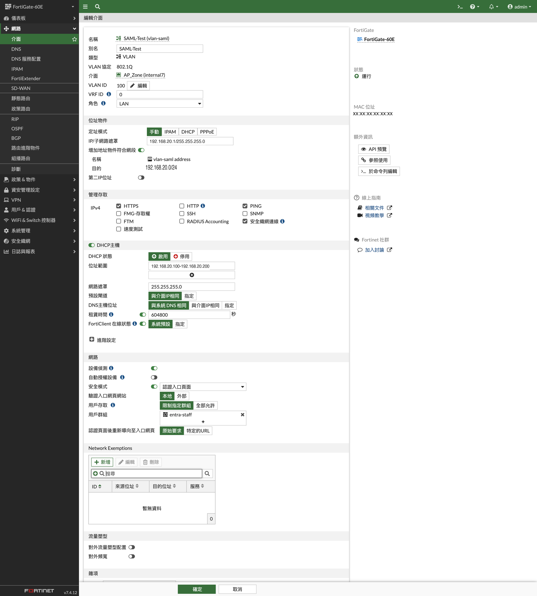

#### 上半段：介面本身（B-1）

| 欄位 | 測試值 | 為什麼重要 |
|---|---|---|
| 名稱 / 別名 | `SAML-Test (vlan-saml)` | |
| 類型 | VLAN，802.1Q | |
| 介面（父介面） | `AP_Zone (internal7)` | ★ **bridge mode 的 AP，父介面是「接交換器的實體介面」**，不是 SSID 介面。tunnel mode 才掛在 SSID 底下，兩者不可混用 |
| VLAN ID | `100` | 要與 SSID 的「可選 VLAN ID」及交換器 trunk 上的 tag 三者一致 |
| 角色 | `LAN` | ★ **必須是 lan 或 undefined**，否則下面的「安全模式」選項不會出現 |
| IP/子網路遮罩 | `192.168.20.1/255.255.255.0` | 使用者的閘道 |
| 管理存取 | ☑ HTTPS ☑ PING | ★ **一定要勾 HTTPS**，否則使用者連不到認證頁 |

#### 中段：DHCP（B-2）

| 欄位 | 測試值 |
|---|---|
| DHCP 主機 | 啟用 |
| 位址範圍 | `192.168.20.100 - 192.168.20.200` |
| 網路遮罩 | `255.255.255.0` |
| 預設閘道 | 與介面 IP 相同 |
| DNS 主機位址 | 與系統 DNS 相同 |

> ⚠️ CLI 推的時候，`dns-service default` 模式下**不能**同時寫 `set dns-server1`，會 parse error。

#### 下半段：Captive Portal（B-8，★ 最後一步）

| 欄位 | 測試值 | 說明 |
|---|---|---|
| 安全模式 | **認證入口頁面** | 這就是 `security-mode captive-portal` |
| 驗證入口網頁網站 | 本地 | 用 FortiGate 自己的 portal |
| 用戶存取 | **限制指定群組** | |
| 用戶群組 | **`entra-staff`** | 對應 `security-groups` |
| 認證頁面後重新導向至入口網頁 | 原始要求 | ★ 這就是「**白畫面 ≠ 失敗**」的來源：認證成功後導回使用者原本要去的網址，那個網址連不上就顯示 Unable to connect |
| Network Exemptions | 目前空 | ★ **正式環境這裡不能空**——見下方警告 |

> ⚠️⚠️ **介面層 captive portal 會強制該介面上「所有」裝置認證。**
> 掃描槍、印表機、IoT、醫療儀器這些永遠過不了 portal，上線前必須全部盤點進
> `security-exempt-list`（就是畫面上的 Network Exemptions），並給固定 IP（放在 DHCP range 之外）。
> **這一項沒盤乾淨，上線當天會炸。**
>
> ⚠️ 介面層的 exempt 與 policy 的 `captive-portal-exempt` **不能互相取代**：
> 前者擋介面層攔截，後者只在流量命中該條政策時作用。

### B-3 無線 SSID（bridge mode）

**GUI 路徑**：WiFi & Switch 控制器 → SSID 管理

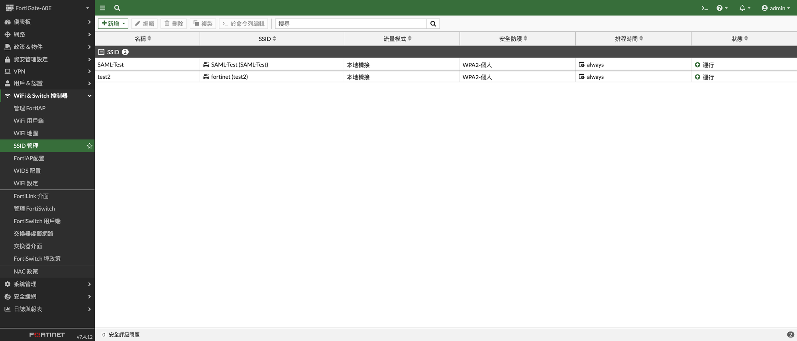

點進 `SAML-Test` 編輯：

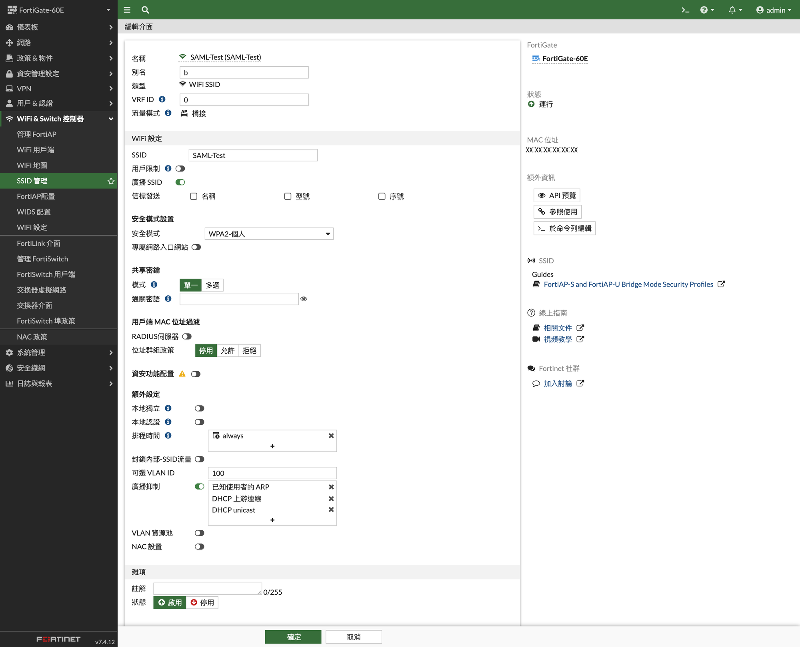

| 欄位 | 測試值 | 說明 |
|---|---|---|
| 流量模式 | **橋接** | 對應 `set local-bridging enable` |
| SSID | `SAML-Test` | |
| 廣播 SSID | 開啟 | |
| 安全模式 | WPA2-個人 | lab 用 PSK；正式環境視需求換 |
| 可選 VLAN ID | **`100`** | 要與 B-1 的 VLAN 介面一致 |
| 排程時間 | always | |

> ★★ **綁定 radio 這一步 GUI 看不到，但漏了 SSID 完全不會廣播**（而且沒有任何錯誤訊息）。
> `wtp-profile` 的 `vap-all` 預設是 `tunnel`，**只會自動綁 tunnel mode 的 SSID**。
> bridge mode 必須改成 `manual` 再手動指定：
>
> ```
> config wireless-controller wtp-profile
> edit "<profile 名稱>"
> config radio-1
> set vap-all manual
> set vaps "SAML-Test"
> end
> next
> end
> ```
>
> 驗證是否在廣播：`diagnose wireless-controller wlac -d vap`，要看到 `wlan=SAML-Test ... vlan_id=100`。

### B-4 SAML server（★ GUI 沒有這一頁，只能走 CLI）

**這是整套設定的核心物件，但 FortiOS 7.4 的 GUI 沒有對應頁面。**
`用戶 & 認證 → 單次登入` 那一頁是**裝置層級**的 `config system saml`（FortiGate 自己當 SP/IdP 做管理登入用，
本機顯示「已停用」），與 captive portal 用的 `config user saml` **是兩回事**，不要看錯。

要看它只能開 CLI 主控台（GUI 右上角的 `>_` 圖示）：

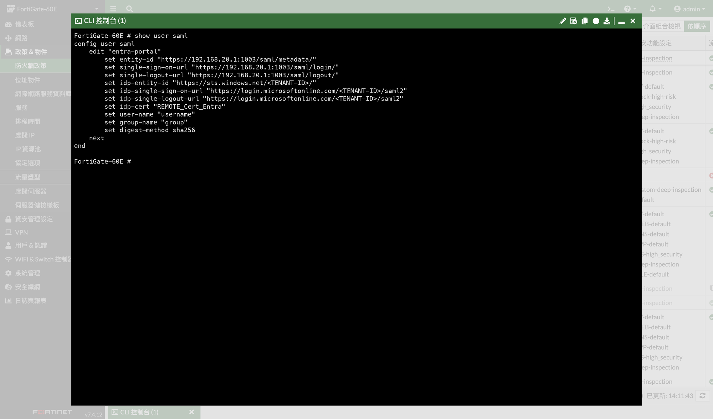

`show user saml` 的完整輸出：

```
config user saml
    edit "entra-portal"
        set entity-id "https://192.168.20.1:1003/saml/metadata/"
        set single-sign-on-url "https://192.168.20.1:1003/saml/login/"
        set single-logout-url "https://192.168.20.1:1003/saml/logout/"
        set idp-entity-id "https://sts.windows.net/<TENANT-ID>/"
        set idp-single-sign-on-url "https://login.microsoftonline.com/<TENANT-ID>/saml2"
        set idp-single-logout-url "https://login.microsoftonline.com/<TENANT-ID>/saml2"
        set idp-cert "REMOTE_Cert_Entra"
        set user-name "username"
        set group-name "group"
        set digest-method sha256
    next
end
```

逐行對照 Entra（可與「Entra ↔ FortiGate 對照總表」互看）：

| 這一行 | 值從哪裡來 |
|---|---|
| `entity-id` | Entra 基本 SAML 設定的**識別碼**（第 2 筆那組） |
| `single-sign-on-url` | Entra 的**回覆 URL**（ACS） |
| `idp-entity-id` | Entra 安裝區塊的 **Microsoft Entra 識別碼**（`sts.windows.net`，結尾有斜線） |
| `idp-single-sign-on-url` / `idp-single-logout-url` | Entra 的**登入／登出 URL**（`login.microsoftonline.com/.../saml2`） |
| `idp-cert` | B-0 匯入的 `REMOTE_Cert_Entra` |
| `user-name` / `group-name` | Entra 屬性與宣告裡的**短名稱** `username` / `group` |
| `digest-method sha256` | ★ **預設是 sha1，Entra 用 SHA-256，不改一定失敗** |

> ★ SP 路徑含 `/saml/` 這一層。**IPsec VPN 用的是 `/remote/saml/`，不要混用。**

### B-5 使用者群組

**GUI 路徑**：用戶 & 認證 → 用戶群組 → 編輯 `entra-staff`

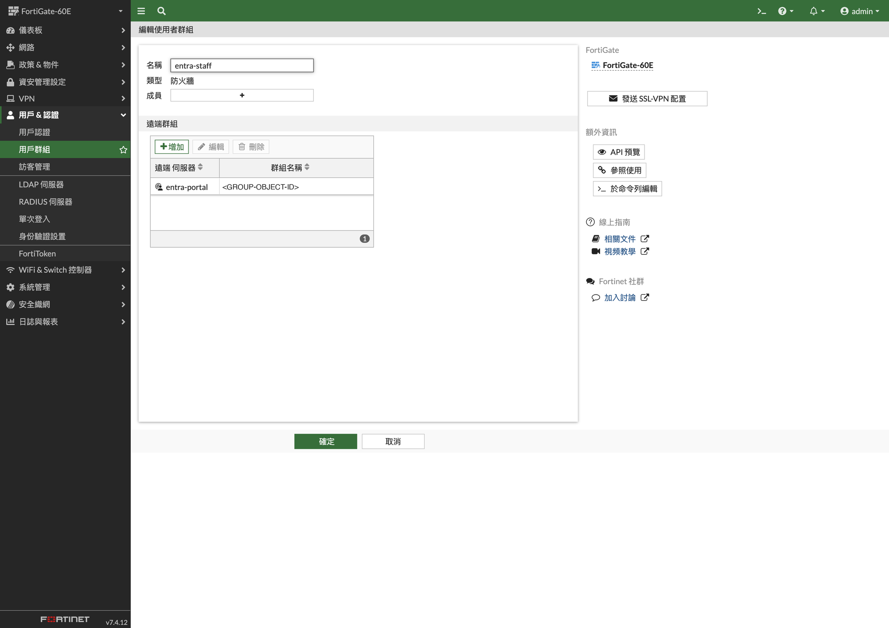

| 欄位 | 測試值 |
|---|---|
| 名稱 | `entra-staff` |
| 類型 | 防火牆 |
| 遠端群組 → 遠端伺服器 | `entra-portal`（B-4 建立的 SAML server） |
| 遠端群組 → 群組名稱 | **`<GROUP-OBJECT-ID>`** |

> ★★ **群組名稱要填 Entra 群組的 Object ID（GUID），不是顯示名稱。**
> Entra 的 group 宣告送出來的就是 GUID，填顯示名稱會變成「登入成功但沒放行」。
> 這是最常見的第二名錯誤（第一名是 exempt 政策沒放行 IdP）。

### B-6 認證通用設定

**GUI 路徑**：用戶 & 認證 → 身份驗證設置

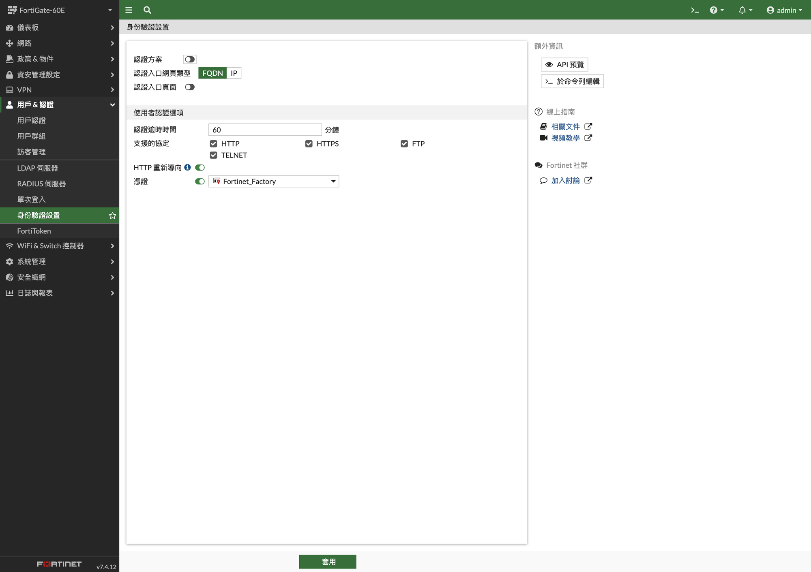

| 欄位 | 測試值 | 說明 |
|---|---|---|
| 認證入口網頁類型 | FQDN | |
| 認證逾時時間 | **60 分鐘** | ★ 單位是**分鐘**不是秒；FortiOS 預設只有 **5 分鐘**，太短。上限 1440 |
| 支援的協定 | HTTP / HTTPS / FTP / TELNET | |
| HTTP 重新導向 | 開啟 | |
| 憑證 | `Fortinet_Factory` | portal 的 TLS 憑證 |

> ★★ **`auth-secure-http` 這個關鍵開關 GUI 上看不到，只能 CLI 設**：
>
> ```
> config user setting
> set auth-secure-http enable
> end
> ```
>
> **預設是 disable**。不開的話 portal 走 HTTP，而 Entra 只接受 `https://` 的回覆 URL，整個流程必失敗。實測踩過。
>
> 另外兩個 CLI-only 的項目：
> ```
> config system global
> set auth-https-port 1003        ← portal 的 https 埠，要與 Entra 回覆 URL 一致
> end
> config firewall auth-portal
> set portal-addr "192.168.20.1"  ← 不設可能與 Entra 回覆 URL 對不上
> end
> ```

### B-7 防火牆政策（★ exempt 在前、認證在後）

#### 先建 FQDN 位址物件

**GUI 路徑**：政策 & 物件 → 位址物件

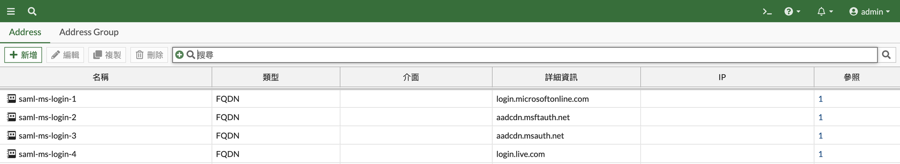

（截圖已裁切，只保留表頭與這四個物件。）

四個 FQDN 物件 `saml-ms-login-1` ~ `saml-ms-login-4`，分別對應：

| 物件 | FQDN |
|---|---|
| saml-ms-login-1 | `login.microsoftonline.com` |
| saml-ms-login-2 | `aadcdn.msftauth.net` |
| saml-ms-login-3 | `aadcdn.msauth.net` |
| saml-ms-login-4 | `login.live.com` |

> ★ **必須用 FQDN 型別，不能寫死 IP**。Microsoft 這些端點是 anycast、多 IP 且會變，寫死一定會漏。
> 清單本身也會變動，上線前建議在現場用 `diagnose sniffer` 抓實際被擋的目的地補齊。

#### 再包成位址群組

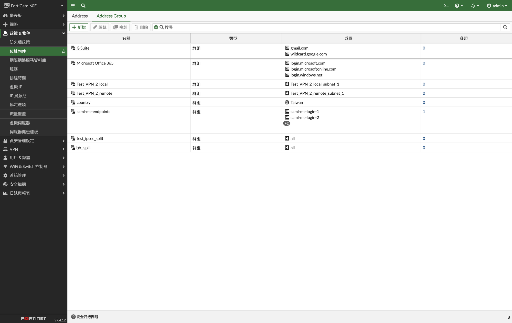

群組 `saml-ms-endpoints` 收納上面四個物件，政策直接引用這個群組。

#### 最後建三條政策，注意順序

**GUI 路徑**：政策 & 物件 → 防火牆政策 →（右上角切「**依順序**」）

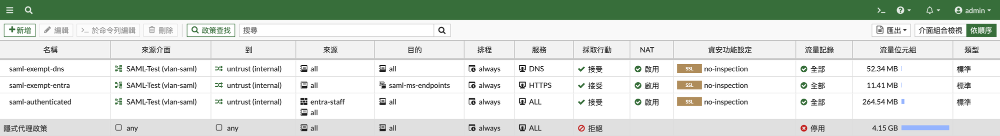

（截圖已裁切，只保留表頭、三條 SAML 相關政策與最底的隱式政策。）

三條政策由上而下：

| 順序 | 名稱 | 來源 | 目的 | 服務 | 關鍵設定 |
|---|---|---|---|---|---|
| 1 | `saml-exempt-dns` | all | all | DNS | `captive-portal-exempt enable` |
| 2 | `saml-exempt-entra` | all | `saml-ms-endpoints` | HTTPS | `captive-portal-exempt enable` |
| 3 | `saml-authenticated` | **`entra-staff`** + all | all | ALL | 綁使用者群組 |

> ★★ **FortiOS 照「政策清單排序 Seq#」比對，不是 policy ID。**
> 在已運作的機器上新增，政策會被追加到清單**最底部**，可能排在既有 catch-all 之後而永遠命中不到。
> 推完必須 `show firewall policy` 確認實際位置，必要時用 `move` 調整。
>
> ★ `captive-portal-exempt` 這個欄位**只能 CLI 設，GUI 上看不到**。
> 所以光看 GUI 無法判斷 exempt 有沒有生效，要用 CLI 覆核。

> 💡 這張圖的另一個價值：流量計數欄位顯示三條政策分別跑過
> **52.34 MB / 11.41 MB / 264.54 MB**，這是整套流程實際跑通的證據，不是設好但沒用過。

---

## 二之二、有線接入情境（FortiSwitch VLAN）

> **狀態：尚未實機驗證**（手上沒有 FortiSwitch）。本節是依「已驗證的無線架構」推導，
> 推導依據見下方。FortiSwitch 到貨後要補一次實機驗證，重點在**埠的 VLAN 指派**與
> **無瀏覽器裝置的豁免行為**。

### 為什麼可以推導

**Captive Portal 是綁在「VLAN 介面」上，不是綁在 SSID 上**——這點在 B-1 那張截圖直接看得到
（「安全模式＝認證入口頁面」是介面設定頁的欄位）。介面上的安全模式對**所有從該介面進入的流量**生效，
與流量來自 AP 還是交換器無關。

所以有線與無線的差別**只在「使用者怎麼被放進那個 VLAN」**，認證段落完全共用。

### 兩種接入的差異

| 比較項目 | 無線（已驗證） | 有線（待驗證） |
|---|---|---|
| 使用者如何進入 | 連上 SSID，AP 以 bridge mode 打 VLAN tag | 插上交換器埠，該埠指派到指定 VLAN |
| VLAN 介面的父介面 | 接 AP 的實體介面（本例 `AP_Zone (internal7)`） | FortiLink 介面（FortiSwitch 由 FortiGate 納管） |
| 需要 SSID | 是（B-3） | 否 |
| 認證機制 | 介面「安全模式＝認證入口頁面」 | **完全相同** |
| SAML server／Entra 設定 | B-4／Part A | **完全共用，不必另建** |

### 有線要做的步驟（只列與無線不同的）

1. **FortiSwitch 以 FortiLink 納管**
2. **建立 VLAN 介面**，`set interface "fortilink"`（其餘同 B-1／B-2：IP、DHCP、`allowaccess https`、role lan）
3. **交換器埠指派 VLAN** — 取代 SSID 這一步。兩種做法：
   - 靜態：直接設定該埠的 native VLAN
   - 動態：FortiSwitch **NAC 政策**依 MAC／裝置類型自動分派（見下方建議）
4. **介面掛 captive portal**（同 B-8）
5. **防火牆政策**：把 B-7 的三條複製一份，來源介面改成有線 VLAN 介面

> ★ 若有線 VLAN 用**不同的 FortiGate IP**，Entra 端要「**增列**」一組識別碼與回覆 URL
> （不是取代）——本例兩組並存就是這個用法，見 A-2 那張編輯畫面。

### 有線特別要注意的四件事

1. **無瀏覽器裝置在有線環境更多**。辦公室網路埠上常見印表機、IP 電話、監視器、門禁、考勤機。
   有線比無線更容易「一插上就斷網」。
   **建議搭配 FortiSwitch NAC 政策**，依裝置類型自動把非電腦裝置丟到免認證 VLAN，
   人用電腦才進 SAML VLAN——這比手工維護 exempt 清單好維護。
2. **語音 VLAN 不要納入 captive portal**。IP 電話靠 LLDP／語音 VLAN 自動取得設定，
   納入認證會讓話機註冊不了。
3. **802.1X 與 captive portal 不能疊在同一介面**，只能擇一。
   已規劃 802.1X 就不需要也不能再套 SAML captive portal（原理見 [SAML 原理與 FortiGate 實作](saml-concepts-fortigate.md) 第六章）。
4. **SAML 依然做不到動態 VLAN**。認證完成時使用者早已拿到 IP，此時換 VLAN 會斷線。
   要依身分分派 VLAN 仍須走 802.1X／NAC。

### 適合／不適合的埠

| 適合 | 不適合 |
|---|---|
| 會議室、訪客座位埠 | 接無瀏覽器裝置的埠 |
| 共用工作站、臨時座位 | 語音 VLAN／IP 電話 |
| 承包商／外部人員專區 | 已導入 802.1X 的埠 |
| 沒有 AD 網域但已有 M365 的環境 | 伺服器機房、不可中斷的網段 |

> 一般辦公埠若使用者本來就用 AD 帳號登入 Windows，再要求 SAML captive portal 會有「重複登入」的體感。
> 這類埠建議走 802.1X 或維持現況，把 SAML 用在訪客與共用區域。

---

## 二之三、多個 VLAN 都要做 SAML 時，要建幾組

**規則：每一個要做 SAML 認證的 VLAN，FortiGate 上都必須有自己的一組 `user saml` ＋ `user group`。不能共用。**
Entra ID 側則相反——**一個企業應用程式、一張憑證就夠**，只是要多掛幾組識別碼與回覆 URL。

> **本節截圖說明**：這一節的畫面來自**驗證環境（FortiOS 7.2.0）**，因為 60E 測試機沒有多 VLAN 設定。
> 欄位名稱、位置與操作邏輯與 7.4.12 相同，僅版面配色略有差異。
> 其餘章節的截圖都是 FortiGate-60E v7.4.12。

### 要建幾份

| 項目 | 數量 | 說明 |
|---|---|---|
| Entra 企業應用程式 | **1 個** | 不必每個 VLAN 一個 |
| Entra 簽章憑證 | **1 張** | 共用 |
| Entra 識別碼（Entity ID） | **每個 VLAN 一組** | 全部加在同一個應用程式裡 |
| Entra 回覆 URL（ACS） | **每個 VLAN 一組** | 同上 |
| Entra 屬性與宣告 | **1 份** | `username`／`group` 設定共用，不必重做 |
| `config user saml` | **每個 VLAN 一個** | entity-id／ACS 用該 VLAN 自己的介面位址 |
| `config user group` | **每個 VLAN 一個** | 因為 group 必須指向各自的 SAML server |
| 防火牆政策 | **每個 VLAN 兩～三條** | exempt IdP／exempt DNS／認證放行 |
| 介面 captive portal | **每個 VLAN 一份** | 各自綁自己的 user group |

**膨脹的全在 FortiGate 側，Entra 側幾乎不用重做。**
十個 VLAN 就是十組 `user saml` ＋ 十個 user group，但 Entra 那邊仍然只有一個應用程式、一張憑證。

### 為什麼不能共用

`config user saml` 裡的 `entity-id` 與 `single-sign-on-url`（ACS）**只能填一個位址**。
而 FortiGate 的 captive portal **只服務「使用者自己進來的那個介面」的 IP**——
其他介面的位址，未認證的使用者連不到（連 ICMP 都不通，即使 `allowaccess` 已開 ping）。

所以兩個 VLAN 共用一組 `user saml` 時會這樣斷：

```
① 攔截        ✅ 正常（每個 VLAN 都在自己的介面上被攔下）
② 導向 Entra   ✅ 正常
③ 使用者登入   ✅ 正常
④ Entra 回傳 Assertion → 送到 ACS 寫的那個位址
                ❌ 那個位址只有其中一個 VLAN 到得了，其他 VLAN 全部卡在這裡
```

**前面三段都正常，斷在最後一哩。** 症狀特別容易誤判：portal 出得來、Microsoft 登入頁也進得去、
帳密也收了，就是登入完回不來。

> ⚠️ **這不是政策沒寫對，寫政策也救不了。**
> FortiGate 上 portal 埠（預設 1000／1003）**沒有任何 listening socket**，
> 它是掛在「啟用 captive portal 的介面」上、只認該介面自己 IP 的轉址規則。
> 加防火牆政策可以打開流量路徑（ICMP 會通），但目標位址上根本沒有服務在接，
> 結果一樣是連線逾時。**集中式 portal 在 FortiOS 上不存在。**

---

### 步驟一：建立各 VLAN 的介面

**GUI 路徑**：網路 → 介面

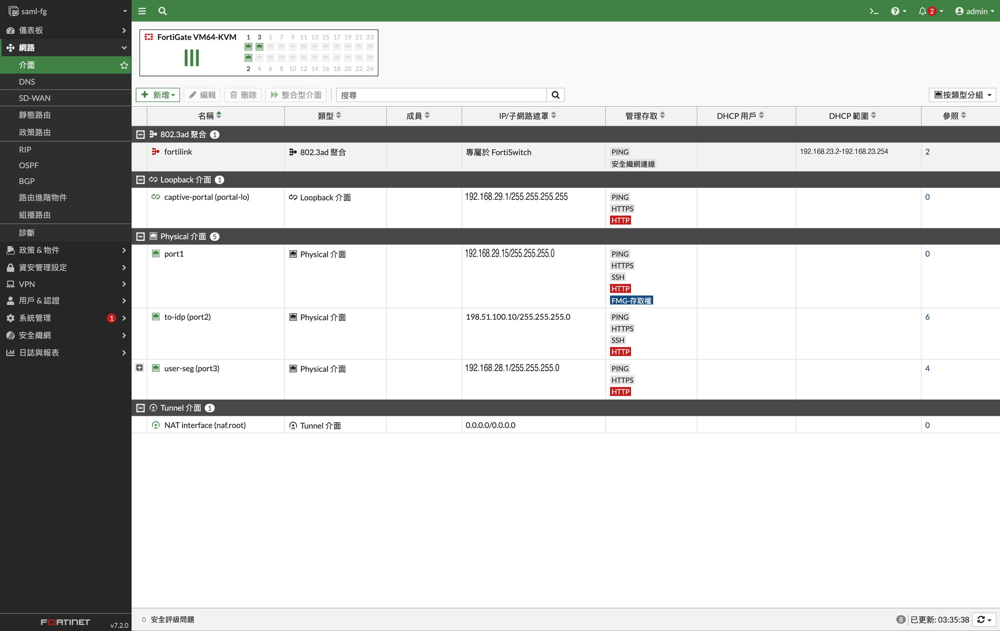

兩個 VLAN 都掛在同一個實體介面（本例 `user-seg (port3)`）底下，各自有獨立網段。
接入端是一台交換器的 trunk 埠，把 VLAN 10／20 的 tag 帶進來。

點進去看單一 VLAN 的完整設定：

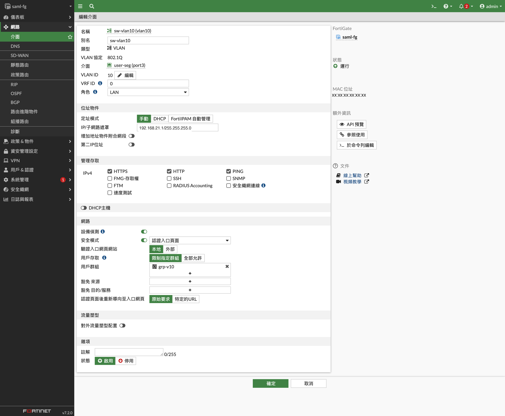

| 欄位 | VLAN 10 | VLAN 20 |
|---|---|---|
| 名稱 | `vlan10`（別名 `sw-vlan10`） | `vlan20`（別名 `sw-vlan20`） |
| 介面（父介面） | `user-seg (port3)` | 同一個 |
| VLAN ID | `10` | `20` |
| IP／遮罩 | `192.168.21.1/255.255.255.0` | `192.168.22.1/255.255.255.0` |
| 角色 | LAN | LAN |
| 管理存取 | HTTPS、HTTP、PING | 同左 |
| 安全模式 | **認證入口頁面** | 同左 |
| 用戶存取 | 限制指定群組 | 同左 |
| **用戶群組** | **`grp-v10`** | **`grp-v20`** ← 這裡不同 |


> ★ 兩張圖唯一的實質差異就是最下面的「**用戶群組**」——這正是「每個 VLAN 一份」的起點。
> 其餘欄位的填法完全一樣，只是位址不同。

### 步驟二：建立各 VLAN 的 SAML 伺服器（CLI）

**GUI 沒有這一頁**，只能用指令列。設定完成後 `show user saml` 應該看到每個 VLAN 各一個物件
（截圖中的 `kc-portal` 是同一台驗證機上另一組以 Keycloak 當 IdP 的測試物件，可忽略）：

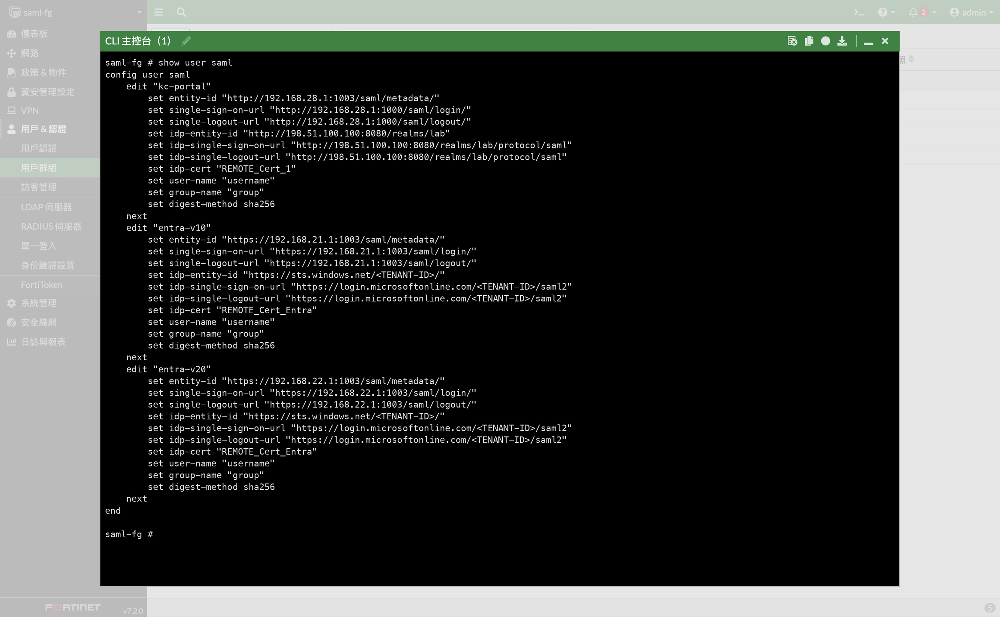

兩個物件結構相同、位址不同：

```
config user saml
edit "entra-v10"
    set entity-id "https://192.168.21.1:1003/saml/metadata/"
    set single-sign-on-url "https://192.168.21.1:1003/saml/login/"
    set single-logout-url "https://192.168.21.1:1003/saml/logout/"
    set idp-entity-id "https://sts.windows.net/<TENANT-ID>/"
    set idp-single-sign-on-url "https://login.microsoftonline.com/<TENANT-ID>/saml2"
    set idp-single-logout-url "https://login.microsoftonline.com/<TENANT-ID>/saml2"
    set idp-cert "REMOTE_Cert_Entra"
    set user-name "username"
    set group-name "group"
    set digest-method sha256
next
edit "entra-v20"
    set entity-id "https://192.168.22.1:1003/saml/metadata/"
    set single-sign-on-url "https://192.168.22.1:1003/saml/login/"
    set single-logout-url "https://192.168.22.1:1003/saml/logout/"
    set idp-entity-id "https://sts.windows.net/<TENANT-ID>/"
    set idp-single-sign-on-url "https://login.microsoftonline.com/<TENANT-ID>/saml2"
    set idp-single-logout-url "https://login.microsoftonline.com/<TENANT-ID>/saml2"
    set idp-cert "REMOTE_Cert_Entra"
    set user-name "username"
    set group-name "group"
    set digest-method sha256
next
end
```

> ★★ **只有前三個欄位要各自不同**（`entity-id`、`single-sign-on-url`、`single-logout-url`），
> 因為它們必須對應該 VLAN 自己的介面位址。
> **`idp-*` 三個欄位、`idp-cert`、`user-name`／`group-name`／`digest-method` 全部共用**——
> 因為 IdP 只有一個、憑證只有一張、宣告設定也只有一份。

### 步驟三：建立各 VLAN 的使用者群組

**GUI 路徑**：用戶 & 認證 → 用戶群組

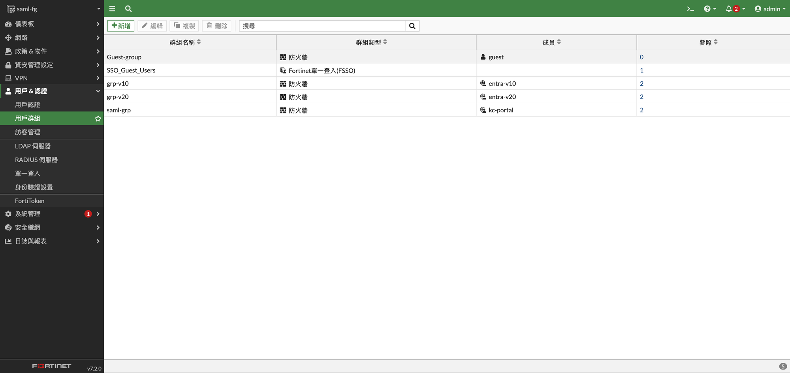

每個 VLAN 一個群組，各自指向自己的 SAML 伺服器：


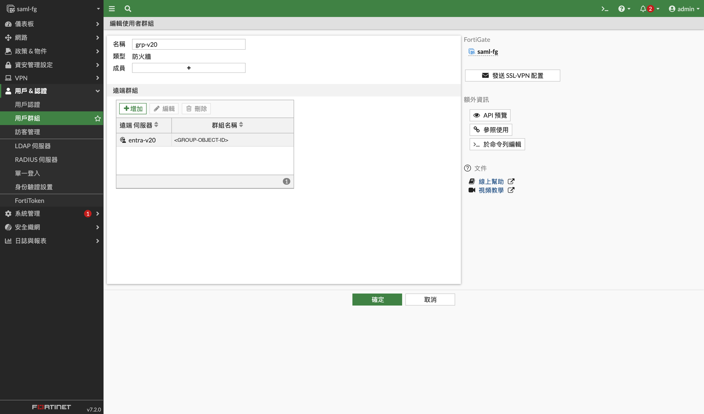

| 欄位 | `grp-v10` | `grp-v20` |
|---|---|---|
| 類型 | 防火牆 | 防火牆 |
| 遠端伺服器 | **`entra-v10`** | **`entra-v20`** ← 不同 |
| 群組名稱（比對值） | `<GROUP-OBJECT-ID>` | 同一個 GUID ← 可相同 |

> ★ **群組物件必須分開**（因為要指向不同的 SAML 伺服器），
> 但**比對的 Entra 群組 Object ID 可以相同**——兩個 VLAN 都只放行同一群人時就填同一個 GUID。
> 要做分權（例如 VLAN 10 給員工、VLAN 20 給訪客）才填不同的 GUID。

### 步驟四：憑證只要一張

**GUI 路徑**：系統管理 → 憑證

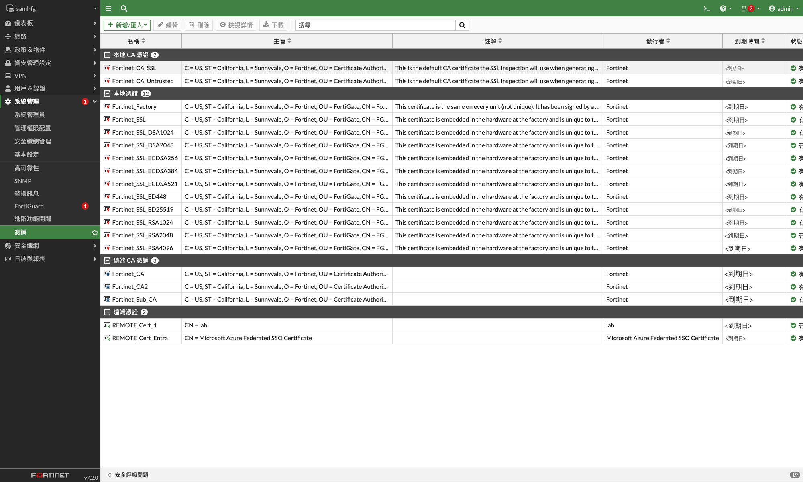

`REMOTE_Cert_Entra` 被**所有 VLAN 的 SAML 伺服器共用**，不需要每個 VLAN 匯一張。
憑證輪替時只換這一張，所有 VLAN 一起生效。

### 步驟五：每個 VLAN 各自的防火牆政策

**GUI 路徑**：政策 & 物件 → 防火牆政策

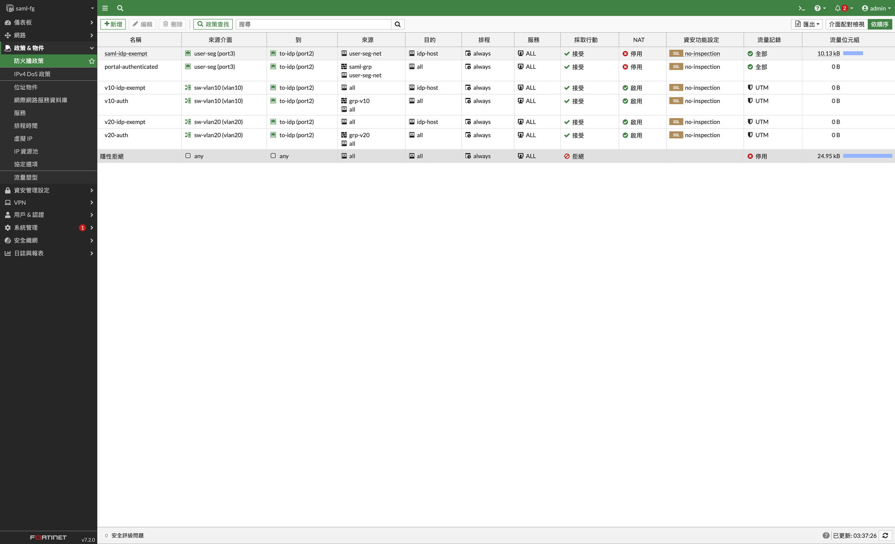

每個 VLAN 都需要自己的政策組（來源介面填該 VLAN），順序一樣是**豁免在前、認證在後**：

| 順序 | 用途 | 關鍵設定 |
|---|---|---|
| 1 | 放行 DNS | `captive-portal-exempt enable` |
| 2 | 放行 Microsoft 登入網域 | 目的填 FQDN 位址群組、`captive-portal-exempt enable` |
| 3 | 認證後放行 | 綁該 VLAN 的 user group |

---

### Entra 側要補什麼

只要在**同一個**企業應用程式的「基本 SAML 設定」裡**增列**（不是取代）：

| 欄位 | VLAN 10 | VLAN 20 |
|---|---|---|
| 識別碼 | `https://192.168.21.1:1003/saml/metadata/` | `https://192.168.22.1:1003/saml/metadata/` |
| 回覆 URL | `https://192.168.21.1:1003/saml/login/` | `https://192.168.22.1:1003/saml/login/` |

實際增列完成的畫面（同一個應用程式掛 4 組識別碼 + 4 組回覆 URL）：

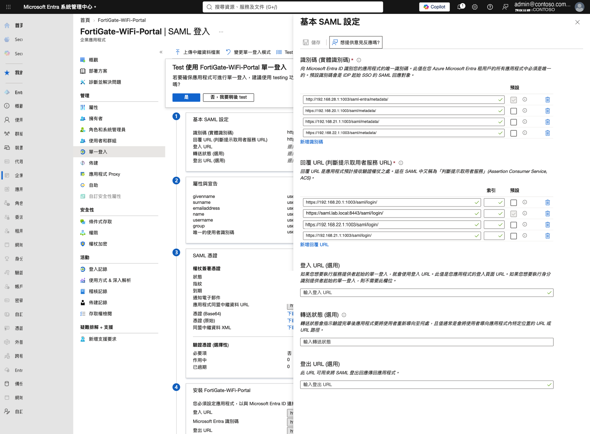

Entra 會拿 SAMLRequest 裡的 Issuer 去比對清單中的識別碼，對到就放行。
**已實測**：增列後從兩個 VLAN 各觸發一次轉導，把 SAMLRequest 送到
`login.microsoftonline.com`，兩邊都回登入頁（增列前會回 `Invalid requester` 類錯誤）。

> ⚠️ **編輯這個表格的三個小坑**（實際操作踩過）：
> 1. 按「新增識別碼／新增回覆 URL」產生的**空白列若沒填值，存檔會被擋**——
>    多個空列會互相被判定「已存在具有相同值」，紅字出現在空列上很容易看不懂。
>    存檔前把用不到的空列用右側垃圾桶刪掉。
> 2. **只在上面兩個表格區塊操作**。下面的「登入 URL／轉送狀態／登出 URL（選用）」
>    三個欄位維持空白，captive portal 用不到；誤填不會立刻報錯，但行為會變。
> 3. 回覆 URL 列旁的「索引」欄是數字欄，**留空即可**，不要填任何文字。

### 不要設 `portal-addr`

多 VLAN 環境**不要**設 `config firewall auth-portal` 的 `portal-addr`。
設了會把所有 VLAN 的使用者都導向同一個位址，而那個位址只有一個網段到得了，
等於自己製造上面那個「斷在最後一哩」的問題。**留空，讓每個 VLAN 用自己的介面位址。**

---

### 驗證方法：解碼 SAMLRequest

要確認每個 VLAN 真的在用自己的那一組，最直接的方法是攔下 SAMLRequest 解碼，
看 `AssertionConsumerServiceURL` 指到哪裡。驗證環境實測結果：

| 用戶端 | AssertionConsumerServiceURL | Destination（IdP） |
|---|---|---|
| VLAN 10 的使用者 | `https://192.168.21.1:1003/saml/login/` | `login.microsoftonline.com/<TENANT-ID>/saml2` |
| VLAN 20 的使用者 | `https://192.168.22.1:1003/saml/login/` | 同上 |

**ACS 各自指向自己的介面、Destination 指向同一個 Entra** ——這就是設定正確的樣子。
若兩個 VLAN 的 ACS 相同，代表它們共用了同一個 `user saml` 物件，其中一個網段一定會登入失敗。

> **驗證狀態**：架構結論以 FortiOS 7.2.0 實測驗證（雙 VLAN、經交換器 trunk 的兩台用戶端、
> 解碼 SAMLRequest 確認 ACS 指向）。**7.4.12 實機尚未複驗**，正式提案前建議在目標版本上再跑一次。

## 三、驗收

驗收指令跑在同一個 CLI 主控台（B-4 那張截圖的視窗）。

> ⚠️ B-4 截圖當下沒有使用者正連著 SAML-Test，`diagnose firewall auth list` 只列出一筆與本文無關的連線，
> 所以公開版截圖已把那段輸出移除。
> 下面的成功範例取自 **2026-07-27 實機驗證當下**的輸出（已去識別化）。

### 成功的唯一判準

```
FGT # diagnose firewall auth list

192.168.20.11, wifiuser@contoso.onmicrosoft.com
    type: fw, id: 0, duration: 39, idled: 3
    server: entra-portal
    group_name: entra-staff
    flag(80): auth
```

要同時看到 **IP + UPN + `server:` + `group_name:` + 有流量**才算成功。

> **白畫面 ≠ 失敗。** 認證成功後 FortiOS 回 303 導回使用者原始請求的網址，
> 那個網址本來就連不上時就顯示「Unable to connect」。一律以上面這行為準，不要看畫面判斷。

### 除錯指令

```
diagnose debug reset
diagnose debug application samld -1
diagnose debug application authd -1
diagnose debug enable
```

測完務必 `diagnose debug disable`。
**每次重測前先 `diagnose firewall auth clear`**——失敗的登入嘗試會留下卡住的 session，
症狀是 captive portal 突然完全不攔截（SYN 三次零回應但 ping 通、設定看起來完全正確）。

### 分層排查

| 症狀 | 卡在哪 | 檢查 |
|---|---|---|
| 網址列完全沒跳轉 | 攔截 | 介面安全模式；或交換器 trunk 沒帶 VLAN tag（先用 sniffer 確認封包有沒有進來，**不要浪費時間查 SAML**） |
| 停在 FortiGate 頁面、到不了 IdP | exempt | **exempt 政策沒放行 IdP／DNS（最常見）** |
| IdP 回 `Invalid requester` | entity-id | 與 Entra 端「識別碼」逐字元比對，含結尾斜線 |
| `ret=101 Signature element not found` | 憑證 | IdP 憑證沒有真的匯入（REST API 靜默失敗） |
| 登入成功但沒放行 | 群組 | Entra 送 GUID，用戶群組要填 Object ID |

---

## 四、GUI 看不到、只能 CLI 的項目（總表）

做圖文教學最容易誤導人的地方：**有幾個關鍵設定 GUI 完全不顯示**，只看畫面會以為設好了。

| 項目 | CLI | 為什麼 GUI 沒有 |
|---|---|---|
| SAML server 本體 | `config user saml` | 7.4 GUI 未實作此頁 |
| portal 走 HTTPS | `config user setting` → `set auth-secure-http enable` | 未開放 |
| portal 埠號 | `config system global` → `set auth-https-port 1003` | 未開放 |
| portal 導向位址 | `config firewall auth-portal` → `set portal-addr` | 未開放 |
| 政策的 captive portal 豁免 | `set captive-portal-exempt enable` | 政策編輯頁不顯示此欄位 |
| SSID 綁 radio | `wtp-profile` → `set vap-all manual` + `set vaps` | GUI 只在 tunnel mode 自動處理 |
| SHA-256 簽章 | `config user saml` → `set digest-method sha256` | 隨 SAML server 一起 |

---

## 相關

- [純文字版設定教學](captive-portal-entra-saml-guide.md) — CLI 指令與完整踩坑總表
- [SAML 原理與 FortiGate 實作](saml-concepts-fortigate.md) — 原理、三角色、Assertion 解剖
