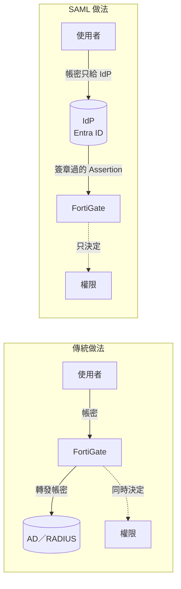
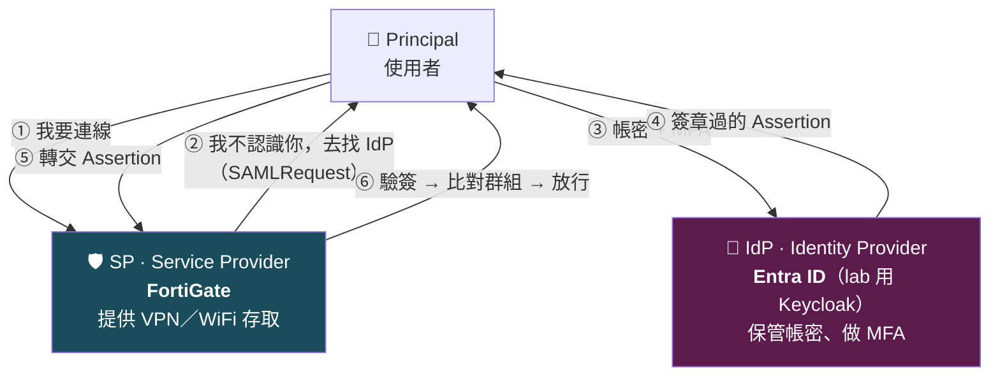
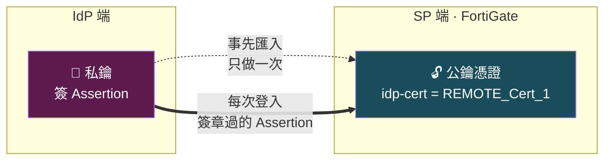
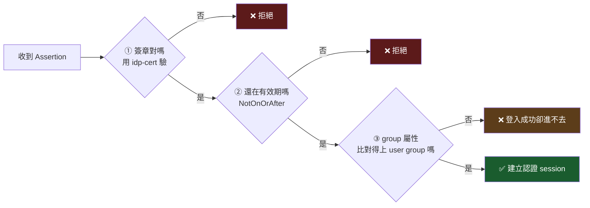
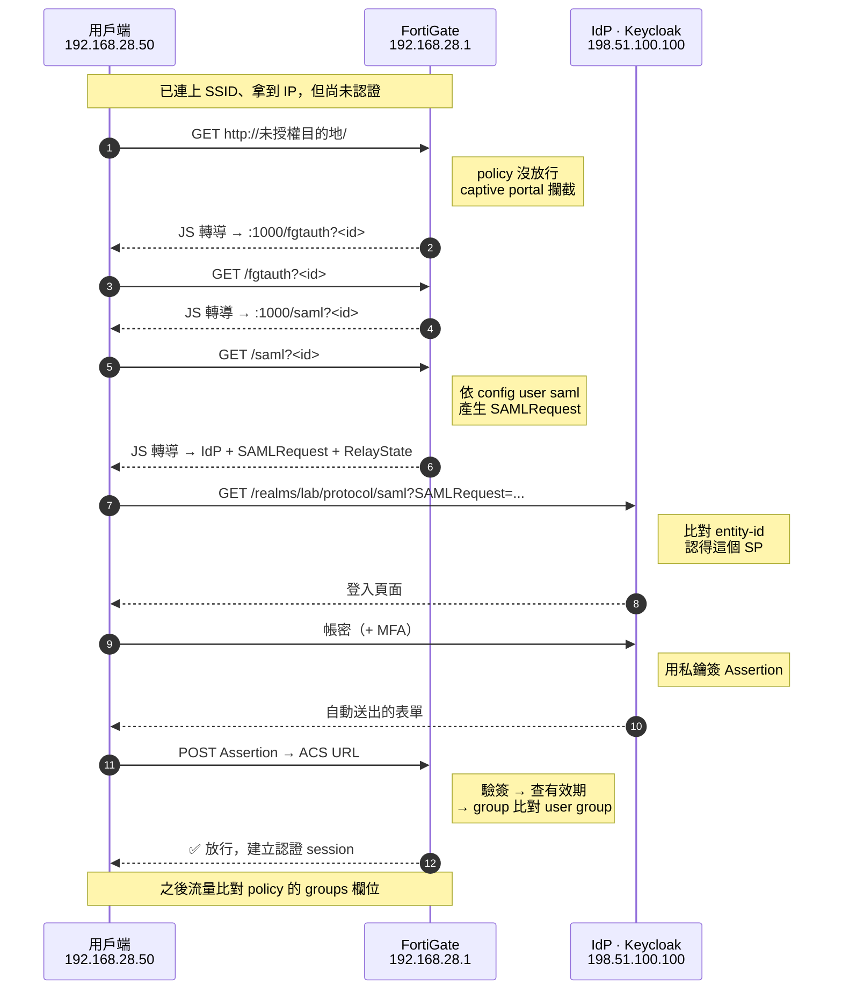
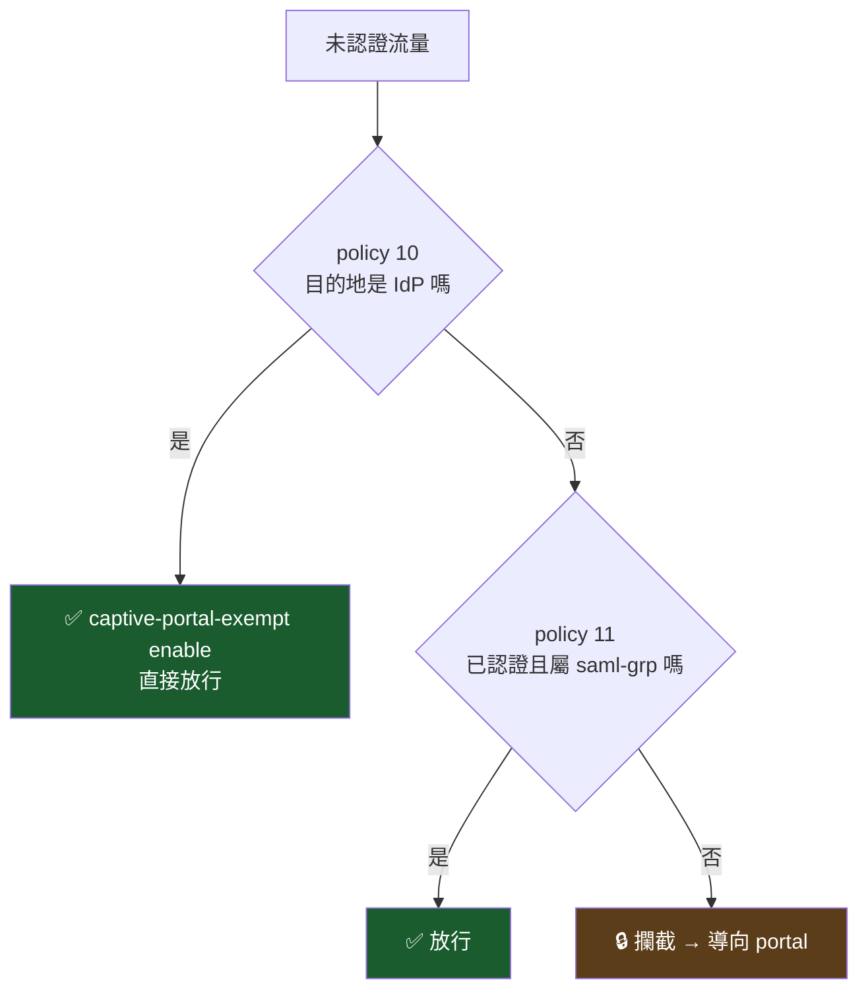
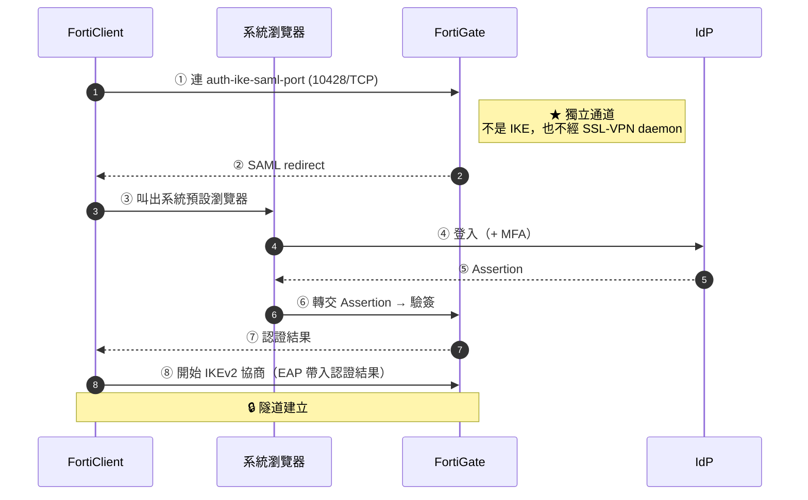
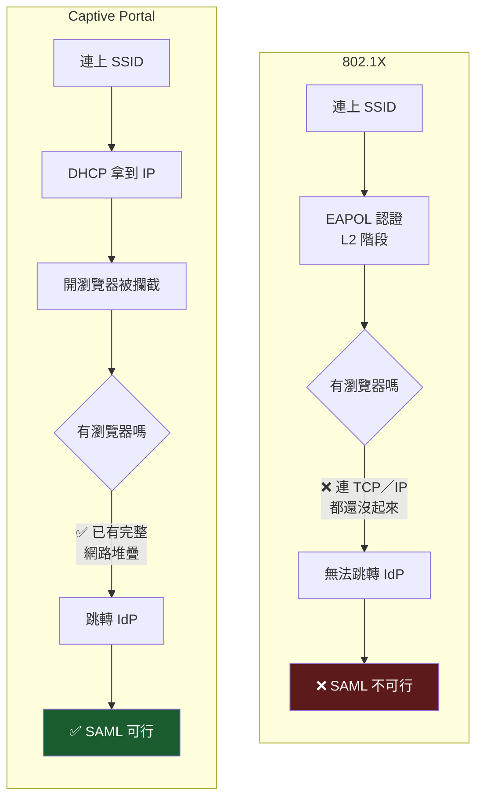
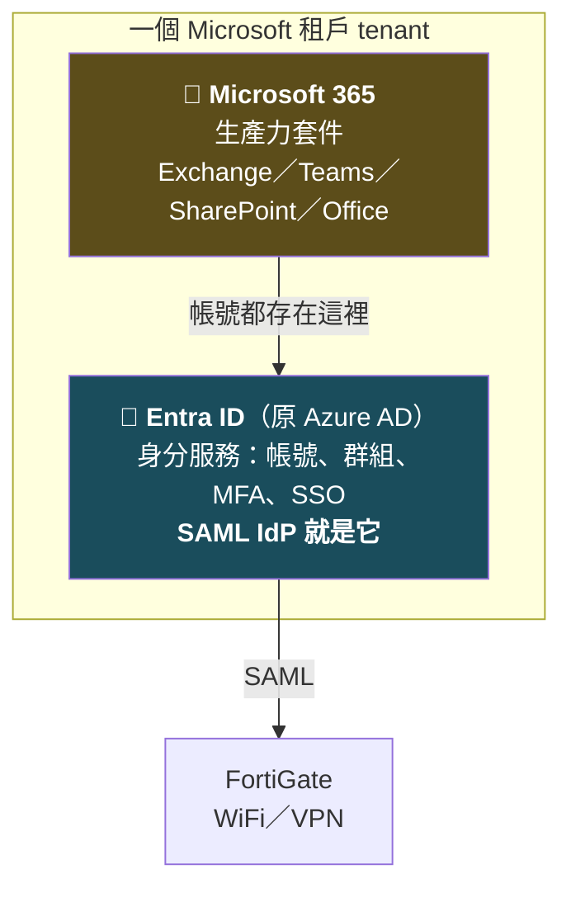
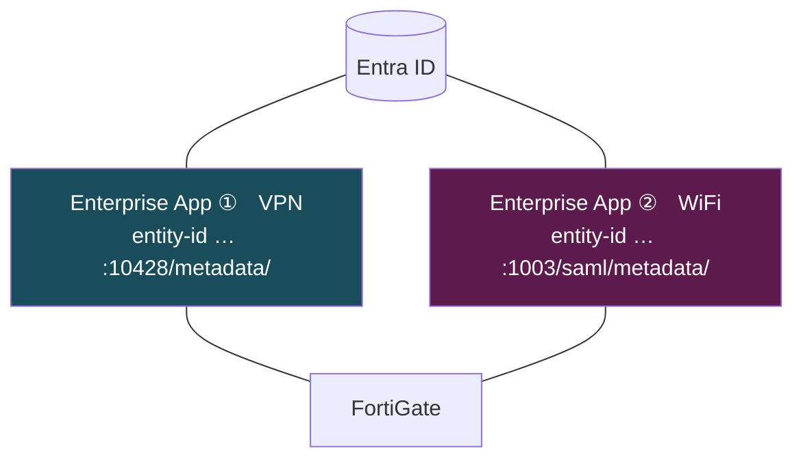

# SAML 原理與 FortiGate 實作

> [!NOTE]
> **測試環境**：FortiGate VM 驗證環境（containerlab），以 Keycloak 當 IdP 做 Captive Portal + SAML 實測（2026-07，原文未標 FortiOS 版本）；Entra ID 實機部分見 [設定教學](captive-portal-entra-saml-guide.md)（FortiOS 7.4.12）。
> VPN 段落原文未註明有實測，語法與版本限制以文末官方文件為準。文中 IP 為示範值。

> [!WARNING]
> 本文是個人學習與實測整理，**僅供參考，使用風險自負**。

用 SAML 取代 WiFi／VPN 的傳統帳密登入，原理、流程、以及每個環節在 FortiGate 設定裡對應哪一行。

流程圖都對照 lab 實測結果，不是紙上談兵。

---

## 一、核心觀念：把「驗證」和「授權」拆開

傳統 RADIUS／LDAP 架構裡，FortiGate 同時做兩件事。SAML 把前者外包出去：



| | 誰做 | 內容 |
|---|---|---|
| **驗證** Authentication | **IdP** | 你是誰？密碼、MFA、條件式存取 |
| **授權** Authorization | **FortiGate** | 你能做什麼？政策、VLAN、頻寬 |

**FortiGate 從頭到尾不知道使用者密碼。** 這是整個架構最大的價值——密碼外洩面縮小到只有 IdP，MFA 與條件式存取也一次到位。

### 三個角色



**關鍵：SP 與 IdP 之間沒有直接連線。** 所有交握都經由使用者的瀏覽器轉送，這叫 *front-channel*。也因此——**沒有瀏覽器就跑不了 SAML**，這個限制決定了後面所有的方案取捨。

---

## 二、信任是怎麼建立的

SP 憑什麼相信一段從瀏覽器轉交過來的 XML？靠**非對稱簽章**。



- IdP 用**私鑰**簽 Assertion，私鑰永不外流
- FortiGate 事先匯入 IdP 的**公鑰憑證**（`set idp-cert "REMOTE_Cert_1"`）
- 每次登入時 FortiGate 用公鑰驗簽

**這張憑證就是整套架構的信任根。** 換掉它、或它過期，全盤失效。

> ⚠️ **lab 最常見的翻車點**：Keycloak 重建過（dev mode 用記憶體內 H2，容器一拆 realm 就沒了），
> 重建 realm 會產生**新的簽章憑證**，此時必須跟著把新憑證重新匯入 FortiGate。
> 否則 FortiGate 還拿著舊公鑰去驗新簽章，症狀是「登入成功但沒放行」。

---

## 三、Assertion 解剖

IdP 簽發的 XML，簡化後長這樣：

```xml
<Assertion>
  <Issuer>http://198.51.100.100:8080/realms/lab</Issuer>   ← 誰簽的
  <Subject>user1</Subject>                                  ← 是誰
  <Conditions NotBefore="..." NotOnOrAfter="..."/>          ← 有效期，防重放
  <AttributeStatement>
    <Attribute Name="username">user1</Attribute>            ← 對應 set user-name "username"
    <Attribute Name="group">wifi-users</Attribute>          ← 對應 set group-name "group"
  </AttributeStatement>
  <Signature>...</Signature>                                ← IdP 私鑰簽章
</Assertion>
```

FortiGate 收到後依序做三件事，**任何一關失敗都直接拒絕**：



### 屬性名稱怎麼對上

`config user saml` 裡的兩個欄位，是在告訴 FortiGate「這包 XML 裡帳號和群組**分別叫什麼名字**」：

```
set user-name "username"    ← 去 Assertion 找 Name="username" 的屬性
set group-name "group"      ← 去 Assertion 找 Name="group" 的屬性
```

**IdP 端的 Claims／Mapper 必須吐出同名的屬性**，否則 FortiGate 抓不到，症狀同樣是「登入成功卻進不去」。

---

## 四、WiFi：Captive Portal 完整流程

這是 lab 實測跑通的路徑。



### 兩個 port 各司其職

| Port | 設定項 | 用途 |
|---|---|---|
| **1000** | `auth-http-port` | portal 的 HTTP 入口（`/fgtauth`、`/saml`）— **實際攔截與轉導走這裡** |
| **1003** | `auth-https-port` | SP 的 entity-id／ACS URL 寫這個 |

> ⚠️ **轉導全是 JavaScript `window.location`，不是 HTTP 302。**
> `curl -L` 跟不了，除錯時要逐段把 URL 撈出來自己接。這是 FortiOS 的正常行為，不是壞掉。

### exempt policy：最常被漏掉的一環

第 ⑧ 步使用者要連到 IdP，但那時候**他還沒通過認證**。如果沒有放行規則，他連登入頁都打不開——portal 永遠轉不過去。



**順序是關鍵：exempt 在前、認證在後。**

```
config firewall policy
    edit 10                                  ← 必須在前
        set dstaddr "idp-host"
        set captive-portal-exempt enable     ← CLI only，GUI 看不到
    next
    edit 11
        set dstaddr "all"
        set groups "saml-grp"                ← 認證後才生效
    next
end
```

正式環境放行 Entra ID 時，目的地要用 FQDN address object（`login.microsoftonline.com`、`*.msauth.net` 等）。**建議在 lab 用 `diagnose sniffer` 抓實際被擋的目的地**——Microsoft 的網域清單會變。

---

## 五、VPN：IPsec IKEv2 + SAML

FortiClient 不是瀏覽器，怎麼跑 SAML？答案是**它自己叫出系統瀏覽器**。



**第 ① 步是 7.4 的關鍵改變**：這是一條走在 IKE 之外的獨立 TCP 通道，所以 **IPsec SAML 不依賴 SSL-VPN daemon，SSL-VPN 可以完全關掉**。

### 三個必要設定

```
config system global
    set auth-ike-saml-port 10428        ← ① 獨立通道的 port
end

config system interface
    edit "wan1"
        set ike-saml-server "azure-ipsec"   ← ② 漏了 = No SAML method found
    next
end

config vpn ipsec phase1-interface
    edit "dialup-saml"
        set ike-version 2               ← ③ 只支援 IKEv2，IKEv1 不行
        set eap enable
        set eap-identity send-request
        set authusrgrp "ipsec-saml-group"
    next
end
```

`ike-saml-server` 沒綁在介面上是**最常見的失敗點**——設定看起來都對，FortiClient 連上去只拿到 `No SAML method found`。

### VPN 的動態授權：比 WiFi 完整

WiFi 做不到動態 VLAN 的時序死結（見第六章）在 VPN **不存在**——mode-cfg 的 IP 分配
發生在 IKE 認證**之後**，且 VPN 流量本來就全部終結在 FortiGate（L2 隔離需求天生由 policy 達成）。

| 層級 | 做法 | SAML |
|---|---|---|
| 多群組→不同存取權 | `authusrgrp` 留空，Assertion 群組直接餵 policy 比對 | ✅ 官方支援 |
| 不同族群→不同 IP pool | 多個 phase1 + IKEv2 `network-id` 區分（EMS 發不同 profile）| ✅ 預先分流 |
| per-user 固定 IP 由回傳決定 | RADIUS `Framed-IP-Address` | ❌ 要改接 RADIUS |

> ⚠️ **官方 KB 178992 明載的坑**：`authusrgrp`（phase1）與 `groups`（policy）
> **兩邊都設 = policy 比對失敗、認證直接掛**。單一群組→只設 authusrgrp；
> 多群組分權→authusrgrp 留空、全交給 policy。

EMS profile 那邊要啟用 **XAuth**（官方原文：啟用 XAuth 後，使用者認證即由 EAP 處理），SAML Port 填 10428，必須與 `auth-ike-saml-port` 一致。

---

## 六、為什麼 802.1X 吃不到 SAML

這是整個題目最重要的技術限制，也是規劃時最需要講清楚的一點。



| | 802.1X | Captive Portal |
|---|---|---|
| 認證時機 | **拿到 IP 之前**（L2） | 拿到 IP 之後（L3） |
| 認證載體 | EAP over LAN | **HTTP，走瀏覽器** |
| 能跳轉瀏覽器嗎 | **不能** | 能 |
| 支援 SAML | ❌ | ✅ |

**這是協定層的硬限制，換任何廠牌都一樣**，不是 Fortinet 的實作問題。

### 推論出來的方案表

| 對象 | 建議方案 | 為什麼 |
|---|---|---|
| 員工筆電／手機 · WiFi | **EAP-TLS**（Intune/SCEP 派憑證） | 使用者無感、不用重複認證，體驗遠優於 portal |
| 員工 · Remote VPN | **IPsec IKEv2 + SAML** | 7.4 主推，順便收掉 SSL-VPN |
| 訪客 WiFi | **Captive Portal + SAML** | 本來就要開瀏覽器接受條款 |
| 掃描槍／IoT／印表機 | **獨立 SSID，PSK + MAC 白名單** | **沒有瀏覽器 = SAML 死路** |

導入前**務必先盤點不能走 SAML 的設備清單**。醫院環境這點特別重要，不然上線當天會炸。

### 延伸限制：SAML 不能做動態 VLAN 分配

RADIUS/802.1X 的動態 VLAN（`Tunnel-Private-Group-Id`）之所以可行，是因為
**VLAN 分配發生在 EAPOL 認證階段、拿 IP 之前**——client 第一次 DHCP 就落在正確網段。

SAML captive portal 認證完成時 **client 早就拿著某個 VLAN 的 IP**，
此時換 VLAN = IP 失效、連線全斷。協定上沒有這個掛勾點，換任何廠牌都一樣。

| | RADIUS 802.1X | SAML Captive Portal |
|---|---|---|
| 分權機制 | 換 VLAN（**L2 隔離**）| 換 firewall policy（L3/L4 過濾）|
| 依據 | RADIUS VSA | Assertion `group` → user group |
| 能做 | 不同網段/DHCP/廣播域 | 不同資源、QoS、UTM profile |
| 不能做 | — | L2 隔離（同一廣播域）|

**SAML 的等價物是「同 VLAN、不同 policy」**——授權彈性不輸，隔離強度不同。
在乎 L2 隔離的環境（如醫療設備網段），這個差異要先講。

要「Entra 身分 + 動態 VLAN」兩個都要 → 混合架構，讓 RADIUS 當中間人：
```
Entra ID ─(群組同步)→ RADIUS（NPS / FortiAuthenticator）─(Tunnel-Private-Group-Id)→ AP
用戶端憑證由 Intune SCEP 派發 → 802.1X EAP-TLS
```
這就是方案表把員工 WiFi 排 EAP-TLS、訪客才走 Captive Portal SAML 的完整理由。

---

## 七、Lab 實測結果（2026-07）

用真瀏覽器完整走完 Captive Portal + SAML（lab 自製的檢查腳本輸出，等同 `diagnose firewall auth list` 的摘要）：

```
═══ 已通過認證的使用者 ═══
  ✓ 192.168.28.50    user1      來源=kc-portal
    群組: saml-grp
    已認證 117s，剩餘 203s，流量 1920 bytes
```

這一行同時證明四件事：

| 證明了什麼 | 對應機制 |
|---|---|
| `user1` | Assertion 的 `username` 屬性抓到了 |
| `來源=kc-portal` | 走的是 SAML server，不是本地帳號 |
| `群組: saml-grp` | **`group` 屬性比對成功** ← 授權邏輯正確 |
| `剩餘 203s` | 認證 session 已建立，有 timeout |


---

## 八之零、先釐清：M365 和 Entra ID 是什麼關係

常被混用，但**不是同一個東西**，而且授權級距會直接影響方案可行性。



| | Microsoft 365 | Entra ID |
|---|---|---|
| 本質 | **應用服務**（信箱、Teams、Office） | **身分服務**（帳號、群組、驗證） |
| 舊名 | Office 365 | **Azure AD**（2023 改名） |
| 跟 SAML 的關係 | 無直接關係 | **SAML IdP 是它** |

**關鍵三句話：**

1. 買了 M365 → **自動就有 Entra ID**（Free 版），帳號都存在 Entra ID 裡
2. 沒買 M365 → **也能單獨用 Entra ID**（開 Azure 訂閱即可）
3. 所以「有沒有 M365」實際在問的是「**有沒有現成的 Entra ID 租戶和已建好的帳號**」

### ⚠️ 授權級距：這才是真正影響方案的地方

| 功能 | Free | P1 | 實務意義 |
|---|---|---|---|
| SAML SSO（自訂應用程式） | ✅ | ✅ | **基本 SAML 登入免費就能做** |
| 群組宣告 `SecurityGroup` | ✅ | ✅ | 可以送出群組，但**只有 GUID** |
| 「指派給應用程式的群組」模式 | ❌ | ✅ | 要拿**群組顯示名稱**得走這條 |
| **條件式存取** | ❌ | ✅ | 裝置合規、地點、風險判斷 |
| 動態群組 | ❌ | ✅ | 依部門自動歸群 |

**兩個實務結論：**

- **只要 SAML 能登入 → Free 就夠**，不必為此加購
- **想要「非公司裝置不准連 VPN」這類控制 → 必須 P1**，這通常才是真正想要的價值

> ⚠️ **群組名稱的坑（和 AWS 一樣）**：Free 版的群組宣告只會送出 **Object ID（GUID）**。
> 想讓 Entra 送出群組「顯示名稱」（`cloud_displayname`），必須把宣告模式改成
> `ApplicationGroup`（「指派給應用程式的群組」）——**而那個模式需要 P1**。
>
> 所以 Free 版上 `set group-name` 只能填 GUID，policy 裡會出現一串看不懂的字串。

> **另一個容易忽略的硬限制**：Microsoft 官方文件明載，
> **SAML assertion 最多送出 150 個群組**（JWT 是 200），含巢狀群組。
> 使用者群組太多會被截斷 → 授權隨機失敗。
> 醫院環境使用者常屬於數十個群組，**規劃時要用「指派給應用程式的群組」收斂範圍**（需 P1）。

---

## 八、換成 Entra ID 要改什麼

lab 用 Keycloak 是為了離線可重現、不污染正式租戶。**FortiGate 側的設定結構完全相同**，只有這些要換：

| Keycloak（lab） | Entra ID（正式） | 注意 |
|---|---|---|
| realm `lab` | tenant | — |
| SAML client | **Enterprise Application** | VPN、WiFi **各一個，不能共用** |
| 群組名 `wifi-users` | **群組 Object ID（GUID）** | ⚠️ 最常見的授權失敗原因 |
| realm 簽章憑證 | App 的 Certificate (Base64) | 會過期，到期就全斷 |
| `…/realms/lab/protocol/saml` | `https://login.microsoftonline.com/<tenant>/saml2` | — |

### 為什麼 VPN 和 WiFi 要兩個 Enterprise Application



兩者的 **port 不同、路徑不同、entity-id 不同**：

| | WiFi | VPN |
|---|---|---|
| Port | `auth-https-port` **1003** | `auth-ike-saml-port` **10428** |
| SP 路徑 | `/saml/metadata/` ← **多一層 `/saml/`** | `/metadata/` |

IdP 靠 entity-id 辨識 SP，兩個不同就是兩個 SP，**必須分開建**。規劃時要先講，不然容易以為建一個就好。

> **Entra 預設丟回來的群組是 GUID 不是顯示名稱。**
> `set group-name` 要填那串 GUID，填顯示名稱會「驗簽成功但授權失敗」——
> 症狀是登入成功卻進不去，而且沒有明顯錯誤訊息，很難查。

---

## 九、可以用 AWS 當 IdP 嗎？

**可以，但群組授權有個官方未支援的坑，先看完再決定。**

AWS 這邊的角色是 **IAM Identity Center**（原 AWS SSO），透過「自訂 SAML 2.0 應用程式」把 FortiGate 當成外部 SP。Fortinet 官方社群有對應的設定文章。

### 三家 IdP 對照

| | Entra ID | AWS IAM Identity Center | Keycloak（lab） |
|---|---|---|---|
| 當 SAML IdP | ✅ 原生 | ✅ 自訂 SAML 2.0 應用程式 | ✅ |
| 帳號來源 | Microsoft 365 租戶 | IAM Identity Center 目錄／外部 IdP | 自建 |
| **群組屬性** | ✅ 官方支援（回 GUID） | ⚠️ **`${user:groups}` 官方未支援**（回 GUID） | ✅ |
| MFA／條件式存取 | ✅ 成熟 | ✅ | 需自建 |
| 適合場景 | 已有 M365 的企業 | 主力在 AWS、無 M365 | lab／POC |

### ⚠️ 最需要注意的一點

AWS IAM Identity Center 的 **`${user:groups}` 屬性會回傳群組 GUID，而且 AWS 官方文件並未正式支援這個用法**、也沒有辦法讓它回傳群組顯示名稱。

這對 WiFi／VPN 場景影響很大——**群組授權正是 WiFi／VPN 分權的核心**（哪些人能進哪個 VLAN、走哪條 policy）。踩到的話：

- 短期：`set group-name` 填 GUID 仍可運作，但**維運可讀性極差**（policy 裡看到一串 GUID，沒人知道那是哪個部門）
- 長期：AWS 沒有承諾相容性，**未來版本可能改變行為**

### 設定骨架（AWS 端）

在 IAM Identity Center 建立「自訂 SAML 2.0 應用程式」，填入 FortiGate 的 SP URL：

| AWS 欄位 | 值（以 WiFi captive portal 為例） |
|---|---|
| Application ACS URL | `https://<FGT-FQDN>:1003/saml/login/` |
| Application SAML audience | `https://<FGT-FQDN>:1003/saml/metadata/` |

屬性對應（Attribute mappings）要吐出 FortiGate 期待的名稱：

| 應用程式屬性 | 對應到 IAM Identity Center |
|---|---|
| `username` | `${user:subject}` |
| `group` | `${user:groups}` ← **就是上面那個未官方支援的** |

FortiGate 端的結構與 Keycloak／Entra 完全相同，只是 URL 與 GUID 換掉：

```
config user saml
    edit "aws-idp"
        set entity-id "https://<FGT-FQDN>:1003/saml/metadata/"
        set single-sign-on-url "https://<FGT-FQDN>:1003/saml/login/"
        set idp-entity-id "<AWS 的 issuer URL>"
        set idp-single-sign-on-url "<AWS 的 sign-in URL>"
        set idp-cert "REMOTE_Cert_N"        ← 從 AWS 下載的憑證
        set user-name "username"
        set group-name "group"
    next
end

config user group
    edit "aws-saml-grp"
        set member "aws-idp"
        config match
            edit 1
                set server-name "aws-idp"
                set group-name "<AWS Group GUID>"
            next
        end
    next
end
```

### 建議

| 情境 | 建議 |
|---|---|
| 已有 M365／Entra ID | **用 Entra ID**，群組屬性有官方支援、文件成熟、醫院企業普及率高 |
| 主力在 AWS、無 M365 | AWS 可行，但**先在 lab 驗證群組屬性**再上線 |
| 只是要做 POC／驗證邏輯 | 繼續用 Keycloak，離線、免費、不污染正式租戶 |

> 醫院、企業環境多半已有 M365，**Entra ID 通常是更穩的選擇**。
> 除非明確要求走 AWS，否則不建議為了用 AWS 而承擔群組屬性的不確定性。

---

## 十、除錯速查

```
diagnose debug reset
diagnose debug application samld -1
diagnose debug application authd -1
diagnose debug enable
```

| 症狀 | 卡在流程哪一段 | 檢查 |
|---|---|---|
| 網址列沒跳轉 | 攔截 | `security-mode captive-portal` 有沒有設 |
| 停在 FortiGate 頁面 | 到不了 IdP | **exempt policy**（最常見） |
| IdP 說 `Invalid requester` | entity-id | 與 IdP 的 client ID **逐字**比對 |
| 登入成功但沒放行 | 驗簽 **或** 群組 | samld debug 找 `signature`；沒有就是群組對不上 |
| `No SAML method found`（VPN） | 介面綁定 | `ike-saml-server` 沒綁在介面上 |

驗收指令：
```
diagnose firewall auth list
```

---

## 相關

- [Captive Portal + Entra ID SAML 設定教學](captive-portal-entra-saml-guide.md) — 實機實測完整教學（Entra + FortiGate 兩側設定、10 個踩坑表）
- [圖文版](captive-portal-entra-saml-illustrated.md) — GUI 截圖對照

## 出處

FortiOS 語法與版本限制以官方文件為準，非憑記憶撰寫：

- [SAML-based authentication for FortiClient remote access dialup IPsec VPN clients — FortiOS 7.6.4](https://docs.fortinet.com/document/fortigate/7.6.4/administration-guide/951346/saml-based-authentication-for-forticlient-remote-access-dialup-ipsec-vpn-clients)
- [Captive portal authentication using SAML credentials — FortiAP 7.4.8](https://docs2.fortinet.com/document/fortiap/7.4.8/fortiwifi-and-fortiap-configuration-guide/806280/captive-portal-authentication-using-saml-credentials)
- [IPsec VPN SAML-based authentication — FortiClient EMS 7.4.7](https://docs.fortinet.com/document/forticlient/7.4.7/ems-administration-guide/712604/ipsec-vpn-saml-based-authentication)
- [Configuring SAML SSO — FortiOS 7.6.4](https://docs.fortinet.com/document/fortigate/7.6.4/administration-guide/254248/configuring-saml-sso)
- [Technical Tip: Configuring SAML SSO login for SSL VPN web mode with AWS as SAML IdP](https://community.fortinet.com/t5/FortiGate/Technical-Tip-Configuring-SAML-SSO-login-for-SSL-VPN-web-mode/ta-p/214297)
- [Set up your own SAML 2.0 application — AWS IAM Identity Center](https://docs.aws.amazon.com/singlesignon/latest/userguide/customermanagedapps-set-up-your-own-app-saml2.html)
- [Map attributes in your application to IAM Identity Center attributes](https://docs.aws.amazon.com/singlesignon/latest/userguide//mapawsssoattributestoapp.html)
- [Configure optional claims（群組宣告、150 群組上限、`cloud_displayname` 限制）— Microsoft Learn](https://learn.microsoft.com/en-us/entra/identity-platform/optional-claims)
- [Microsoft Entra licensing — Microsoft Learn](https://learn.microsoft.com/en-us/entra/fundamentals/licensing)
- [Microsoft Entra Conditional Access 總覽（P1 需求）— Microsoft Learn](https://learn.microsoft.com/en-us/entra/identity/conditional-access/overview)
